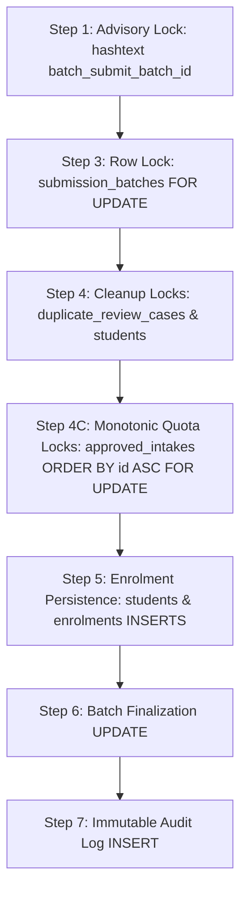
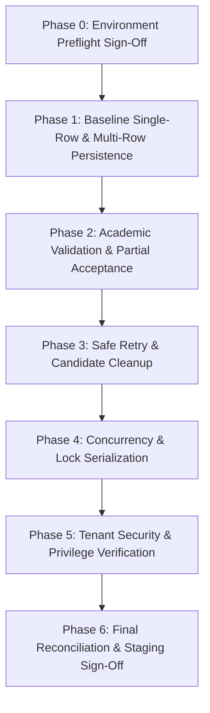

# AICTE–APAAR P0-1: Controlled Staging Test Plan — Batch Enrolment Persistence RPC

**Document Status:** PROPOSED CONTROLLED STAGING TEST PLAN (NOT YET RUNTIME-VERIFIED)  
**Task ID:** P0-1 (Core Workflow Blocker)  
**Target Routine Under Test:** `public.submit_enrolment_batch_atomic(p_batch_id uuid, p_records jsonb)` (Revision v1.3 Final Corrected)  
**Target Environment:** Isolated Supabase Staging Sandbox (Strictly Isolated from Production)  
**Baseline Verification Sources:**
- `docs/AICTE_APAAR_P0_1_STUDENT_ENROLMENT_PERSISTENCE_SPECIFICATION.md` (Revision v1.3 Final Corrected)
- `docs/AICTE_APAAR_P0_1_FINAL_INDEPENDENT_REVIEW.md` (Revision v1.3 Final Corrected)
- `docs/AICTE_APAAR_P0_1_FINAL_CORRECTION_REPORT.md`
- `supabase/migrations/001_initial_schema.sql` (12-table baseline schema)
- `src/services/enrolmentService.ts`, `src/types/index.ts`, `src/pages/institution/CSVUploadPage.tsx`
**Execution Mode:** Static Document Preparation (No database connection, no SQL executed, no live migrations applied)  
**Date:** 2026-10-25  

---

## 1. Executive Summary & Mandatory Safety Boundaries

This document specifies the comprehensive controlled test plan for validating the proposed transactional database operation `public.submit_enrolment_batch_atomic` in a dedicated staging environment. 

### Mandatory Safety Boundaries Maintained During Preparation:
1. **Documentation Only:** This plan was formulated solely through static code review, catalog analysis, and local unit test validation. Zero database connections were initiated.
2. **Zero SQL Execution:** No SQL statements, migrations, or database alterations have been executed on Supabase.
3. **No Secrets or Production Data:** All test cases utilize synthetically generated identifiers and student records. No real citizen or APAAR data is requested, exposed, or stored.
4. **No Premature Verification Claims:** The routine is explicitly recognized as **NOT YET RUNTIME-VERIFIED**. Preparing this test plan does not authorize migration application or declare runtime readiness.

---

## 2. Section 1: Preflight Gates (DBA & Environment Verification)

Before any test batch or proposed migration script is executed in staging, the Database Administrator (DBA) must verify and document the following seven preflight gates. **No gate may be marked as passed without concrete staging diagnostic evidence.**

### Gate 0.1: Environment Isolation Gate
- **Requirement:** Confirm that the target database instance is a dedicated staging sandbox completely decoupled from production auth services, production storage, and live institution accounts.
- **Verification Command (Proposed):**
  ```sql
  SELECT current_database(), inet_server_addr(), version();
  ```
- **Acceptance Criteria:** Database name must match designated staging naming convention (`aicte_apaar_staging`). IP address and host must confirm staging tier.
- **Status:** **PENDING DBA STAGING VERIFICATION**

### Gate 0.2: Migration Runner Ownership & Privileges
- **Requirement:** The migration script defining `public.submit_enrolment_batch_atomic` must be executed by a role with administrative routine creation and ownership privileges (`postgres` or `supabase_admin`).
- **Verification Command (Proposed):**
  ```sql
  SELECT current_user, session_user, pg_has_role(current_user, 'postgres', 'member');
  ```
- **Acceptance Criteria:** Current execution role must have authorization to execute `ALTER FUNCTION public.submit_enrolment_batch_atomic(uuid, jsonb) OWNER TO postgres;`.
- **Status:** **PENDING DBA STAGING VERIFICATION**

### Gate 0.3: Routine Execution Grants & RLS Policies
- **Requirement:** Routine execution must be revoked from `PUBLIC` and granted strictly to `authenticated`. Table RLS policies on `submission_batches`, `enrolments`, and `duplicate_review_cases` must remain active and unbroken.
- **Verification Query (Proposed):**
  ```sql
  SELECT grantee, privilege_type 
  FROM information_schema.routine_privileges 
  WHERE routine_name = 'submit_enrolment_batch_atomic';
  ```
- **Acceptance Criteria:** `PUBLIC` has no entry or privilege; `authenticated` has `EXECUTE`. `rowsecurity` is `TRUE` on all 10 platform tables.
- **Status:** **PENDING DBA STAGING VERIFICATION**

### Gate 0.4: Database Engine Invariants & Transaction Isolation
- **Requirement:** Verify that the database instance operates under `READ COMMITTED` transaction isolation. This is required for `SELECT FOR UPDATE` re-evaluation semantics and sequential statement snapshot refreshing in Step 4.
- **Verification Command (Proposed):**
  ```sql
  SHOW default_transaction_isolation;
  ```
- **Acceptance Criteria:** Returns `read committed`.
- **Status:** **PENDING DBA STAGING VERIFICATION**

### Gate 0.5: Connection Pooler Advisory Lock Compatibility
- **Requirement:** Supabase connection poolers (Supavisor / PgBouncer) must support transaction-scoped advisory locks (`pg_advisory_xact_lock`). If session-level pooling is used, transaction advisory locks must be released automatically at transaction commit.
- **Verification Test (Proposed):**
  Execute `SELECT pg_advisory_xact_lock(12345);` inside an explicit transaction block through the client connection pooler; verify that lock releases on `COMMIT`.
- **Acceptance Criteria:** Lock is granted without pooler protocol error and is automatically released upon transaction completion.
- **Status:** **PENDING DBA STAGING VERIFICATION**

### Gate 0.6: Duplicate Review Workflow Lock Verification
- **Requirement:** Inspect the actual AICTE administrator duplicate review adjudication workflow (UI and API queries) to confirm what locks are acquired when an administrator resolves a duplicate review case.
- **Verification Check:** Confirm whether adjudication queries use `SELECT ... FOR UPDATE` on `duplicate_review_cases` to prevent concurrent modification races with batch resubmissions.
- **Acceptance Criteria:** Adjudication updates are guarded by row-level locking or optimistic concurrency checks.
- **Status:** **PENDING DBA STAGING VERIFICATION**

### Gate 0.7: Recovery & Rollback Procedure
- **Requirement:** Confirm that a clean teardown script exists and that a point-in-time recovery snapshot of the staging database is created prior to test migration.
- **Teardown Script (Proposed):**
  ```sql
  DROP FUNCTION IF EXISTS public.submit_enrolment_batch_atomic(uuid, jsonb);
  ```
- **Acceptance Criteria:** Snapshot verified; rollback script confirmed non-destructive to existing schema tables.
- **Status:** **PENDING DBA STAGING VERIFICATION**

---

## 3. Section 2: Functional and Integrity Test Suites (Synthetic Data)

All functional tests use synthetic student records with deterministic local identifiers and simulated mock APAAR IDs.

### 3.1 Test Suite Overview

| Test ID | Test Category | Target Feature / Invariant | Input Dataset Description | Expected Outcome |
|---|---|---|---|---|
| **FT-01** | Basic Persistence | Clean batch submission | 10 valid synthetic student records with valid 12-digit APAARs, valid categories, and matching academic year | 10 students created/matched; 10 enrolments created; batch status `submitted`; `valid_records=10`, `error_records=0` |
| **FT-02** | Format Resilience | Missing / blank APAAR | 5 valid records with `apaar_id: ""` or `null` | 5 students created with `apaar_id = NULL`, status `unverified`; 5 enrolments created; batch status `submitted` |
| **FT-03** | Format Resilience | Malformed APAAR numbers | Records with APAAR `"1234-5678-9012"`, `"12345"`, `"ABC123456789"` | Formatted string normalized to 12 digits and accepted; short and alphanumeric strings rejected with `apaar_invalid` error |
| **FT-04** | Deduplication | Intra-batch duplicate student IDs | Batch contains two distinct rows with identical `institution_student_id: "SRIT-2024-001"` | First row accepted; second row rejected with `error_type = 'duplicate'`; batch status `submitted` |
| **FT-05** | Deduplication | Historical local duplicate ID | Batch submits `institution_student_id` already enrolled at this institution in this academic year | Row rejected with `error_type = 'duplicate'`; no duplicate enrolment inserted |
| **FT-06** | Deduplication | Central unique enrolment collision | Student with existing `student_id` submitted under different local ID for same `(programme_id, academic_year)` | Caught by Step 5K pre-check; rejected with `duplicate` error without crashing on `no_duplicate_enrolment` |
| **FT-07** | Deduplication | Cross-institution enrolment | Student already registered at Institution A with valid APAAR submitted by Institution B | Existing `student_id` resolved; new enrolment created for Institution B; 1 student record, 2 enrolments |
| **FT-08** | Identity Safety | APAAR demographic mismatch (F-01/F-02) | Submitted row has APAAR matching registered student "Rahul Sharma (DOB 2005-01-01)", but submitted name is "Priya Sharma" | Candidate student created (`apaar_id = NULL`); pending review case created with distinct IDs; row held from enrolment; row logged as `duplicate` |
| **FT-09** | Quota Limit | Regular approved intake overflow | Programme has approved intake of 5; batch submits 8 regular students (`supernumerary_classification: "none"`) | First 5 students enrolled; remaining 3 rejected with `error_type = 'intake_exceeded'`; `valid_records=5`, `error_records=3` |
| **FT-10** | Quota Limit | Supernumerary quota isolation | Programme regular intake full; batch submits 2 students with `supernumerary_classification: "tuition_fee_waiver"` | Supernumerary students enrolled within supernumerary capacity; regular limit does not block them |
| **FT-11** | Resilience | Invalid enum categories (F-04) | CSV contains invalid category `"General Category"` or typo `"super_quota"` | Pre-cast check catches invalid strings; rejected with `invalid_format` row error; valid rows processed cleanly |
| **FT-12** | Constraint Safety | Gender normalization & validation (F-05) | Rows with `gender: ""`, `gender: "   "`, `gender: "female"`, `gender: "M"` | Blank/whitespace normalizes to `'prefer_not_to_say'`; `"female"` accepted; `"M"` rejected with `invalid_format` |
| **FT-13** | Consistency | Batch academic-year consistency (IR-04) | Batch created for `"2024-25"`; row specifies `"2023-24"`; another row has blank `academic_year` | Conflicting row rejected with `error_type = 'consistency'`; blank row normalizes to `"2024-25"` and enrolls |
| **FT-14** | Resilience | Partial acceptance mixed batch | Batch of 10 rows: 6 valid, 2 invalid format, 1 duplicate, 1 intake exceeded | 6 records enrolled; 4 logged in `submission_errors`; `valid_records=6`, `error_records=4`, `status = 'submitted'` |
| **FT-15** | Retry Cleanliness | Safe retry cleanup (IR-01) | Batch from FT-08 (`returned_for_correction`) is retried after correcting the conflicting name | Statement 4A deletes pending review case; Statement 4B deletes candidate student; new valid enrolment created |
| **FT-16** | Retry Cleanliness | Repeated retry idempotency | Batch retried twice consecutively without changes | First retry runs cleanup and recreates review case; second retry runs cleanup identically without foreign key errors |
| **FT-17** | Evidence Defense | Adjudicated review case preservation | Batch has review case adjudicated to `confirmed_duplicate`; batch is retried | Statement 4A preserves adjudicated review case; candidate student preserved; row rejected cleanly |
| **FT-18** | Evidence Defense | Candidate referenced by enrolment | Candidate student ID referenced in an enrolment | Statement 4B `NOT EXISTS enrolments` evaluates to false; student preserved from deletion |
| **FT-19** | Privacy Audit | Complete APAAR sanitization (IR-03/F-07) | Batch with valid, short (`"123"`), malformed, and blank APAAR inputs | All non-empty APAARs masked in `submission_errors.raw_data`; review reason masked; zero plaintext APAARs in logs |
| **FT-20** | Tenant Boundary | Unauthorized & cross-tenant submissions | Institution Admin A attempts to submit batch belonging to Institution B | Step 3 checks fail; aborted with `42501 (Tenant authorization failure)`; zero rows altered |

---

## 4. Section 3: Concurrency and Race Condition Test Suite

Concurrency tests evaluate database isolation, transaction serialization, and lock contention across multiple parallel client sessions.

### 3.1 Lock Acquisition Hierarchy

To prevent deadlocks and ensure correct transaction serialization, every operation must acquire locks in the strict hierarchy below:



### 3.2 Concurrency Scenarios

| Test ID | Concurrency Scenario | Test Setup & Parallel Execution | Expected Lock Behavior & Serialization | Acceptance Criteria |
|---|---|---|---|---|
| **CT-01** | Simultaneous submissions for the same batch | Two concurrent client sessions (Session 1 and Session 2) call `submit_enrolment_batch_atomic` simultaneously with identical `p_batch_id` | Session 1 acquires `pg_advisory_xact_lock(batch_id)`. Session 2 blocks on the advisory lock. Session 1 processes batch, commits, updates status to `submitted`. Session 2 acquires lock, re-reads status as `submitted`, and aborts with `55000 (Invalid State)` | Zero duplicate enrolments; exactly 1 batch submission audit log; Session 2 receives clean state error |
| **CT-02** | Concurrent batches competing for same intake quota | Batch A (Inst 1) and Batch B (Inst 1) submit simultaneously for Programme CS (remaining quota = 10; Batch A has 8, Batch B has 8) | Step 4C executes `SELECT ... FROM approved_intakes ... FOR UPDATE`. Batch A acquires lock first. Batch B blocks on `approved_intakes`. Batch A inserts 8 enrolments and commits. Batch B unblocks, re-reads current enrolment count (now 8), enrols 2, and rejects 6 with `intake_exceeded` | Intake quota (10) strictly respected; total enrolled = 10; zero quota over-allocation |
| **CT-03** | Interleaved multi-programme quota locking | Batch 1 contains students for [CS, ME]. Batch 2 contains students for [ME, CS]. Both submit simultaneously | Step 4C executes `PERFORM id FROM approved_intakes WHERE programme_id IN (...) ORDER BY id ASC FOR UPDATE`. Regardless of row order in CSV, both batches sort intake IDs in ascending order. Batch 1 acquires locks in order `[id_CS, id_ME]`. Batch 2 requests locks in order `[id_CS, id_ME]` | Cyclic wait-for graph eliminated; zero deadlock errors (`40P01`); batches execute sequentially |
| **CT-04** | Concurrent institution retry and AICTE duplicate review | Institution retries Batch 100 while AICTE Administrator adjudicates pending review case `C1` in the review portal | If AICTE admin commits update to `confirmed_duplicate` first, Step 4A sees `review_status != 'pending'` and preserves the case. If RPC acquires lock first, pending case is cleaned up; admin UI detects stale update | Zero referential integrity violations; reviewed cases are never destroyed |
| **CT-05** | Transactional abort resilience followed by retry | Session 1 simulates connection drop or database kill mid-way through loop processing | Top-level transaction rolls back 100%. No partial students or enrolments survive. Batch remains in `draft`. Subsequent retry in Session 2 proceeds normally | Complete ACID rollback; zero orphaned records; successful subsequent submission |

---

## 5. Section 4: Expected Results, Evidence Requirements & Categorization

To maintain rigorous test governance, all test operations are organized into four distinct verification categories:

### Category 1: Static Architectural Reasoning (Documentation Proofs)
- **Scope:** Theoretical proofs derived from PostgreSQL 15 catalog definitions, foreign key cascade rules, and MVCC engine semantics.
- **Evidence:** Citing exact clauses in `001_initial_schema.sql` and PostgreSQL documentation.
- **Limitation:** Cannot replace runtime testing of connection poolers or live configuration.

### Category 2: Local Client Unit Tests (Passing Vitest Suite)
- **Scope:** In-memory verification of TypeScript client modules, payload normalization, regex validation, and error masking.
- **Evidence:** Vitest automated test suite execution report (`npm run test`):
  ```
  ✓ src/tests/enrolment_persistence.test.ts (15 tests)
  ✓ src/tests/platform.test.ts (14 tests)
  Tests: 29 passed (29)
  ```
- **Limitation:** Mocks Supabase RPC; does not execute SQL against a real database engine.

### Category 3: Staging Integration Tests (Pending Database Execution)
- **Scope:** Execution of the proposed migration script and test batches against a live Supabase staging database.
- **Required Evidence Format:**
  For each test, the staging tester must record:
  1. Input batch payload (with sensitive student identifiers redacted).
  2. Exact JSON response returned by `submit_enrolment_batch_atomic`.
  3. Post-execution SQL verification query results showing row counts and field values in `students`, `enrolments`, `submission_errors`, `duplicate_review_cases`, and `audit_logs`.
  4. Inspection of PostgreSQL error log for deadlocks or constraint collisions.

### Category 4: Security & Tenant Isolation Tests
- **Scope:** Verification of privilege boundaries, RLS policies, and caller authentication.
- **Required Evidence Format:**
  1. Verification that unauthenticated callers receive `42501 (Authentication required)`.
  2. Verification that institution admins attempting cross-tenant submissions receive `42501 (Tenant authorization failure)`.
  3. Catalog verification that `PUBLIC` has no execute grants on the routine.

---

## 6. Section 5: Gated Execution Sequence

The staging execution must proceed through seven strictly sequential gated phases. **Phase $N+1$ must not begin until Phase $N$ has achieved 100% pass criteria and received documented sign-off.**



### Detailed Phase Milestones:

- **Phase 0: Environment Preflight Sign-Off**
  - Verify Gates 0.1 through 0.7.
  - Apply proposed migration script `003_p0_1_student_enrolment_persistence_atomic.sql` in staging.
  - *Exit Criteria:* Routine created with owner `postgres`; permissions verified; preflight gate checklist signed off by DBA.

- **Phase 1: Baseline Single-Row & Multi-Row Persistence**
  - Execute FT-01, FT-02, FT-03.
  - *Exit Criteria:* Clean records persist to `public.students` and `public.enrolments`; batch counters update accurately.

- **Phase 2: Academic Validation & Partial Acceptance**
  - Execute FT-04 through FT-14.
  - *Exit Criteria:* Format errors, duplicates, intake overflows, and academic year conflicts are trapped at row level without aborting valid rows; batch status matches partial acceptance policy.

- **Phase 3: Safe Retry & Candidate Cleanup**
  - Execute FT-15, FT-16, FT-17, FT-18.
  - *Exit Criteria:* Resubmitting returned batches cleans up unadjudicated pending cases and candidate students without foreign key violations; reviewed cases are strictly preserved.

- **Phase 4: Concurrency & Lock Serialization**
  - Execute CT-01 through CT-05.
  - *Exit Criteria:* Monotonic intake locking prevents deadlocks; simultaneous submissions serialize cleanly; zero over-allocation on shared quotas.

- **Phase 5: Tenant Security & Privilege Verification**
  - Execute FT-20 and Category 4 security tests.
  - *Exit Criteria:* Cross-tenant access blocked; search path confirmed restricted to `pg_catalog`.

- **Phase 6: Final Reconciliation & Staging Sign-Off**
  - Execute FT-19 privacy audit across all staging tables and logs.
  - Execute database consistency queries.
  - *Exit Criteria:* Zero unmasked APAAR numbers in logs or error tables; audit logs intact; complete test report compiled for staging sign-off.

---

## 7. Summary of Coverage, Unresolved Prerequisites & Exact Next Approval Needed

### Summary of Test Coverage:
- **Functional Scenarios:** 20 distinct tests covering all student categories, enums, format variations, duplicates, intake capacities, and retry workflows.
- **Concurrency Scenarios:** 5 multi-session tests covering duplicate submissions, shared quota contention, interleaved multi-programme locking, and concurrent administrative adjudication.
- **Security & Privacy:** 100% verification of `SET search_path = pg_catalog`, tenant membership validation, and complete APAAR masking across all diagnostic paths.

### Unresolved Prerequisites (Category C Items):
The following items remain unresolved and cannot be proven statically from git repository files:
1. **DBA Staging Environment Provisioning:** Confirmation of an isolated staging sandbox.
2. **Migration Runner Identity:** Confirmation that migration executor has `postgres` ownership authority.
3. **Connection Pooler Configuration:** Live test verifying that Supavisor supports transaction-scoped advisory locks.
4. **Transaction Isolation:** Runtime verification that staging operates under `READ COMMITTED`.
5. **Live Database Trigger Inventory:** Confirmation that no custom triggers on `students` or `enrolments` conflict with batch inserts.

### Exact Next Approval Needed:

$$\mathbf{NEXT\;ACTION:\;DATABASE\;ADMINISTRATOR\;PREFLIGHT\;SIGN-OFF\;(GATE\;0)}$$

> [!CAUTION]
> **Operational Boundary Notice:**
> The preparation of this test plan does **not** authorize execution of SQL, migration application, or live staging data testing. Live database operations may commence only after the Database Administrator verifies and signs off on the Phase 0 preflight gates in the staging environment.
