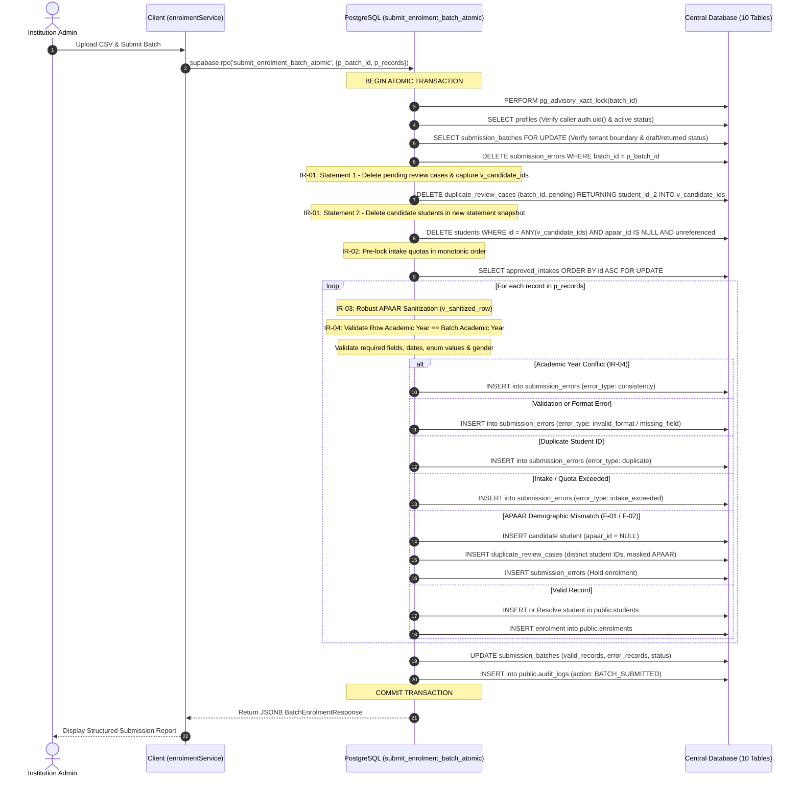

# AICTE–APAAR P0-1: End-to-End Student & Enrolment Persistence Specification (v1.3 Final Corrected)

**Document Status:** PROPOSED DATABASE SPECIFICATION & MIGRATION — REVIEW ONLY (DO NOT EXECUTE DIRECTLY)  
**Revision:** v1.3 (Final Correction Pass — Resolving IR-01 Sequential Candidate Cleanup)  
**Task ID:** P0-1 (Core Workflow Blocker)  
**Target Repository:** `D:\aicte-apaar-platform`  
**Scope:** Server-Side Transactional Batch Enrolment RPC (`public.submit_enrolment_batch_atomic`)  
**Database Engine:** PostgreSQL 15+ / Supabase PostgreSQL  
**Date:** 2026-10-25  
**Verdict:** **DOCUMENTATION CORRECTED — AWAITING CONTROLLED STAGING TEST PLAN**

---

## 1. Executive Summary & Objective

In the baseline prototype implementation, the CSV upload wizard (`src/pages/institution/CSVUploadPage.tsx`) parsed student records in client memory, created a single summary row in `public.submission_batches`, and **discarded all parsed student rows**. No rows were persisted to `public.students` or `public.enrolments`.

This specification provides the design and proposed SQL implementation for the trusted database operation:
$$\mathbf{public.submit\_enrolment\_batch\_atomic(p\_batch\_id\;uuid,\;p\_records\;jsonb)}$$

This function executes inside a single PostgreSQL ACID transaction, verifies caller authorization against the institution and batch, locks the batch and intake quotas against concurrent race conditions, validates each student record against academic constraints, inserts accepted records into `students` and `enrolments`, logs rejected records in `submission_errors`, updates batch counters, emits an immutable audit log entry, and returns a structured outcome payload.

### Corrections Incorporated in Revision v1.3:
1. **IR-01 (Sequential Two-Statement Candidate Cleanup):** In Step 4, unadjudicated pending review cases (`review_status = 'pending'`) belonging to `p_batch_id` are deleted and their exact `student_id_2` candidate IDs are captured into an array variable `v_candidate_ids`. A separate, subsequent SQL command then deletes candidate records from `public.students` bounded strictly to `id = ANY(v_candidate_ids)` where `apaar_id IS NULL`, zero enrolments exist, and no remaining review cases reference them. Because this runs as a subsequent command, its statement snapshot directly observes the preceding review-case deletions, eliminating MVCC snapshot shielding.
2. **IR-02 (Deterministic Quota-Lock Ordering):** In Step 4C, all intake quota rows for distinct programmes present in `p_records` are pre-locked in a monotonic sorted order (`ORDER BY id ASC FOR UPDATE`) prior to processing individual student records, eliminating cyclic lock deadlocks (`40P01`) between concurrent batches.
3. **IR-03 (Complete APAAR Sanitization):** In Step 5, any non-empty APAAR string—including short (1–3 digits), malformed, or whitespace values—is completely masked in `v_sanitized_row` before persisting to `submission_errors.raw_data` or logs.
4. **IR-04 (Batch Academic-Year Consistency):** The authoritative academic year is derived from the locked `submission_batches` record (`v_batch_ay`). Any row whose explicit `academic_year` conflicts with `v_batch_ay` is rejected at the row level with `error_type = 'consistency'` in `submission_errors`. Blank or missing values are safely normalized to `v_batch_ay`.

---

## 2. Architecture & Transactional Execution Flow



---

## 3. Proposed SQL Migration Code (PROPOSED — NOT EXECUTED)

The SQL migration script below contains the complete implementation of the atomic persistence routine:

```sql
-- =============================================================================
-- MIGRATION: 003_p0_1_student_enrolment_persistence_atomic.sql
-- PURPOSE: Atomic RPC for batch student enrolment persistence in PostgreSQL.
-- REVISION: v1.3 (Final Corrected: Resolving IR-01 Sequential Candidate Cleanup)
-- COMPLIANCE:
--   - PostgreSQL 15+ / Supabase
--   - Problem 2 Routine Privilege Reconciliation Policy
--   - Problem 3 SECURITY DEFINER & pg_catalog search_path Rules
-- STATUS: PROPOSED SPECIFICATION — DO NOT APPLY WITHOUT DBA APPROVAL
-- =============================================================================

BEGIN;

CREATE OR REPLACE FUNCTION public.submit_enrolment_batch_atomic(
  p_batch_id uuid,
  p_records jsonb
)
RETURNS jsonb
LANGUAGE plpgsql
SECURITY DEFINER
SET search_path = pg_catalog
AS $$
DECLARE
  v_caller_id uuid;
  v_caller_role public.user_role;
  v_caller_inst_id uuid;
  v_batch_inst_id uuid;
  v_batch_ay text;
  v_batch_status public.batch_status;
  
  -- Iteration variables
  v_row jsonb;
  v_row_num integer;
  v_inst_student_id text;
  v_full_name text;
  v_prog_code text;
  v_ay text;
  v_row_ay text;
  v_adm_date date;
  v_adm_category public.admission_category;
  v_is_nri boolean;
  v_is_oci boolean;
  v_is_fn boolean;
  v_sup_class public.supernumerary_classification;
  v_apaar text;
  v_dob date;
  v_gender text;
  v_remarks text;

  -- Programme & Intake lookup
  v_prog_id uuid;
  v_intake_id uuid;
  v_approved_intake integer;
  v_total_supernumerary integer;
  v_current_regular integer;
  v_current_supernumerary integer;

  -- Student & Enrolment persistence
  v_student_id uuid;
  v_candidate_student_id uuid;
  v_enrolment_id uuid;
  v_existing_student_id uuid;
  v_existing_name text;
  v_existing_dob date;
  v_case_id uuid;
  v_candidate_ids uuid[];

  -- Counters & Results
  v_accepted_count integer := 0;
  v_rejected_count integer := 0;
  v_duplicate_count integer := 0;
  v_row_results jsonb := '[]'::jsonb;
  v_final_status public.batch_status;
  
  -- Deduplication tracking
  v_seen_ids text[] := ARRAY[]::text[];
  v_is_supernumerary boolean;
  v_raw_cat text;
  v_raw_sup text;
  v_sanitized_row jsonb;

  -- Sanitization helpers
  v_raw_apaar_str text;
  v_digits_only text;
  v_masked_apaar text;
BEGIN
  -- ---------------------------------------------------------------------------
  -- STEP 1: CONCURRENCY LOCK
  -- ---------------------------------------------------------------------------
  IF p_batch_id IS NULL THEN
    RAISE EXCEPTION 'p_batch_id cannot be null' USING ERRCODE = '22023';
  END IF;

  -- Transaction-level advisory lock serializes submissions for this specific batch
  PERFORM pg_advisory_xact_lock(hashtext('batch_submit_' || p_batch_id::text));

  -- ---------------------------------------------------------------------------
  -- STEP 2: CALLER AUTHENTICATION & AUTHORIZATION GUARD
  -- ---------------------------------------------------------------------------
  v_caller_id := auth.uid();
  IF v_caller_id IS NULL THEN
    RAISE EXCEPTION 'Authentication required: session user is null' USING ERRCODE = '42501';
  END IF;

  SELECT role, institution_id INTO v_caller_role, v_caller_inst_id
  FROM public.profiles
  WHERE id = v_caller_id AND is_active = TRUE;

  IF NOT FOUND THEN
    RAISE EXCEPTION 'Caller profile not found or inactive' USING ERRCODE = '42501';
  END IF;

  -- ---------------------------------------------------------------------------
  -- STEP 3: BATCH ROW LOCK & TENANT MEMBERSHIP VERIFICATION
  -- ---------------------------------------------------------------------------
  SELECT institution_id, academic_year, status
  INTO v_batch_inst_id, v_batch_ay, v_batch_status
  FROM public.submission_batches
  WHERE id = p_batch_id
  FOR UPDATE;

  IF NOT FOUND THEN
    RAISE EXCEPTION 'Submission batch % does not exist', p_batch_id USING ERRCODE = '22023';
  END IF;

  -- Enforce tenant boundary: institution admin must belong to the batch institution
  IF v_caller_role != 'aicte_admin'::public.user_role THEN
    IF v_caller_inst_id IS NULL OR v_caller_inst_id != v_batch_inst_id THEN
      RAISE EXCEPTION 'Tenant authorization failure: caller cannot submit batch for institution %', v_batch_inst_id
        USING ERRCODE = '42501';
    END IF;

    -- Verify active membership in institution_memberships table
    IF NOT EXISTS (
      SELECT 1 FROM public.institution_memberships
      WHERE profile_id = v_caller_id
        AND institution_id = v_batch_inst_id
        AND is_active = TRUE
    ) THEN
      RAISE EXCEPTION 'Tenant authorization failure: caller is not an active member of institution %', v_batch_inst_id
        USING ERRCODE = '42501';
    END IF;
  END IF;

  -- Batch state machine guard: only 'draft' or 'returned_for_correction' batches can be submitted
  IF v_batch_status NOT IN ('draft'::public.batch_status, 'returned_for_correction'::public.batch_status) THEN
    RAISE EXCEPTION 'Batch % is in status %, which cannot be submitted', p_batch_id, v_batch_status
      USING ERRCODE = '55000';
  END IF;

  IF p_records IS NULL OR jsonb_array_length(p_records) = 0 THEN
    RAISE EXCEPTION 'p_records cannot be empty' USING ERRCODE = '22023';
  END IF;

  -- ---------------------------------------------------------------------------
  -- STEP 4: SAFE RETRY CLEANUP (Resolves IR-01)
  -- Deletes prior errors and removes unadjudicated pending review cases for this
  -- batch, capturing exact candidate IDs. Subsequent command cleans up orphaned
  -- candidate students with full snapshot visibility and strict referential safety.
  -- ---------------------------------------------------------------------------
  DELETE FROM public.submission_errors WHERE batch_id = p_batch_id;

  -- 4A. Delete pending duplicate review cases for this batch and capture candidate IDs
  WITH deleted_cases AS (
    DELETE FROM public.duplicate_review_cases
    WHERE batch_id = p_batch_id 
      AND review_status = 'pending'::public.duplicate_review_status
    RETURNING student_id_2
  )
  SELECT COALESCE(array_agg(student_id_2), ARRAY[]::uuid[])
  INTO v_candidate_ids
  FROM deleted_cases;

  -- 4B. Clean up candidate students in subsequent command with updated snapshot visibility
  -- Deletes candidate students ONLY IF:
  -- 1. In the exact candidate ID set from this batch's deleted pending cases.
  -- 2. apaar_id IS NULL (never deletes registered citizen records).
  -- 3. No enrolments reference the student.
  -- 4. No remaining review cases (adjudicated or from other batches) reference the student.
  IF v_candidate_ids IS NOT NULL AND array_length(v_candidate_ids, 1) > 0 THEN
    DELETE FROM public.students
    WHERE id = ANY(v_candidate_ids)
      AND apaar_id IS NULL
      AND NOT EXISTS (
        SELECT 1 FROM public.enrolments 
        WHERE student_id = students.id
      )
      AND NOT EXISTS (
        SELECT 1 FROM public.duplicate_review_cases 
        WHERE student_id_1 = students.id OR student_id_2 = students.id
      );
  END IF;

  -- ---------------------------------------------------------------------------
  -- STEP 4C: DETERMINISTIC QUOTA-ROW LOCKING (Resolves IR-02)
  -- Pre-locks all distinct active intake quota rows required by this batch in 
  -- monotonic primary-key order (ORDER BY id ASC) to prevent concurrent deadlocks.
  -- ---------------------------------------------------------------------------
  PERFORM id 
  FROM public.approved_intakes
  WHERE programme_id IN (
    SELECT p.id 
    FROM public.programmes p
    JOIN (
      SELECT DISTINCT upper(trim(COALESCE(r->>'programme_code', ''))) AS prog_code
      FROM jsonb_array_elements(p_records) AS r
      WHERE r->>'programme_code' IS NOT NULL AND trim(r->>'programme_code') != ''
    ) codes ON p.code = codes.prog_code
    WHERE p.institution_id = v_batch_inst_id
      AND p.programme_status = 'approved'::public.programme_status
  )
  AND academic_year = v_batch_ay
  AND status = 'active'
  ORDER BY id ASC
  FOR UPDATE;

  -- ---------------------------------------------------------------------------
  -- STEP 5: ROW-BY-ROW VALIDATION AND ATOMIC PERSISTENCE LOOP
  -- ---------------------------------------------------------------------------
  FOR v_row IN SELECT * FROM jsonb_array_elements(p_records)
  LOOP
    v_row_num := (v_row->>'row_number')::integer;
    v_inst_student_id := trim(COALESCE(v_row->>'institution_student_id', ''));
    v_full_name := trim(COALESCE(v_row->>'full_name', ''));
    v_prog_code := upper(trim(COALESCE(v_row->>'programme_code', '')));
    v_adm_date := NULL;
    v_dob := NULL;
    v_apaar := NULL;
    v_student_id := NULL;
    v_candidate_student_id := NULL;
    v_enrolment_id := NULL;

    -- Complete APAAR Sanitization (Resolves IR-03)
    -- Masks every non-empty APAAR string (including short/malformed values)
    v_sanitized_row := v_row;
    IF v_sanitized_row ? 'apaar_id' AND v_sanitized_row->>'apaar_id' IS NOT NULL THEN
      v_raw_apaar_str := trim(v_sanitized_row->>'apaar_id');
      v_digits_only := regexp_replace(v_raw_apaar_str, '[^0-9]', '', 'g');
      
      IF v_raw_apaar_str = '' THEN
        v_masked_apaar := '';
      ELSIF length(v_digits_only) >= 4 THEN
        v_masked_apaar := 'XXXXXXXX' || substring(v_digits_only FROM length(v_digits_only) - 3 FOR 4);
      ELSE
        v_masked_apaar := 'XXXXXXXX';
      END IF;

      v_sanitized_row := jsonb_set(v_sanitized_row, '{apaar_id}', to_jsonb(v_masked_apaar));
    END IF;

    -- 5A. Batch Academic-Year Consistency Enforcement (Resolves IR-04)
    -- Authoritative academic year is pinned to v_batch_ay. Conflicting rows are rejected.
    v_row_ay := trim(COALESCE(v_row->>'academic_year', ''));
    IF v_row_ay != '' AND v_row_ay != v_batch_ay THEN
      INSERT INTO public.submission_errors (batch_id, row_number, institution_student_id, error_type, field_name, error_message, raw_data)
      VALUES (
        p_batch_id, 
        v_row_num, 
        v_inst_student_id, 
        'consistency', 
        'academic_year', 
        'Row academic year "' || v_row_ay || '" conflicts with batch academic year "' || v_batch_ay || '"', 
        v_sanitized_row
      );

      v_rejected_count := v_rejected_count + 1;
      v_row_results := v_row_results || jsonb_build_object(
        'row_number', v_row_num,
        'institution_student_id', v_inst_student_id,
        'status', 'rejected',
        'error_type', 'consistency',
        'error_message', 'Academic year conflicts with batch'
      );
      CONTINUE;
    END IF;
    v_ay := v_batch_ay;

    -- Date parsing with exception safety
    BEGIN
      IF v_row->>'admission_date' IS NOT NULL AND v_row->>'admission_date' != '' THEN
        v_adm_date := (v_row->>'admission_date')::date;
      END IF;
    EXCEPTION WHEN OTHERS THEN
      v_adm_date := NULL;
    END;

    BEGIN
      IF v_row->>'date_of_birth' IS NOT NULL AND v_row->>'date_of_birth' != '' THEN
        v_dob := (v_row->>'date_of_birth')::date;
      END IF;
    EXCEPTION WHEN OTHERS THEN
      v_dob := NULL;
    END;

    -- 5B. Safe Enum Validation for Admission Category (Fixes F-04)
    v_raw_cat := lower(trim(COALESCE(v_row->>'admission_category', 'general')));
    IF v_raw_cat IN ('general', 'sc', 'st', 'obc', 'ews', 'pwd', 'nri', 'oci', 'foreign_national', 'management_quota', 'other') THEN
      v_adm_category := v_raw_cat::public.admission_category;
    ELSE
      INSERT INTO public.submission_errors (batch_id, row_number, institution_student_id, error_type, field_name, error_message, raw_data)
      VALUES (p_batch_id, v_row_num, v_inst_student_id, 'invalid_format', 'admission_category', 'Invalid admission category: ' || v_raw_cat, v_sanitized_row);

      v_rejected_count := v_rejected_count + 1;
      v_row_results := v_row_results || jsonb_build_object(
        'row_number', v_row_num,
        'institution_student_id', v_inst_student_id,
        'status', 'rejected',
        'error_type', 'invalid_format',
        'error_message', 'Invalid admission category'
      );
      CONTINUE;
    END IF;

    -- 5C. Safe Enum Validation for Supernumerary Classification (Fixes F-04)
    v_raw_sup := lower(trim(COALESCE(v_row->>'supernumerary_classification', 'none')));
    IF v_raw_sup IN ('none', 'nri', 'oci', 'fn', 'pwd_extra', 'tuition_fee_waiver', 'kashmiri_migrants') THEN
      v_sup_class := v_raw_sup::public.supernumerary_classification;
    ELSE
      INSERT INTO public.submission_errors (batch_id, row_number, institution_student_id, error_type, field_name, error_message, raw_data)
      VALUES (p_batch_id, v_row_num, v_inst_student_id, 'invalid_format', 'supernumerary_classification', 'Invalid supernumerary classification: ' || v_raw_sup, v_sanitized_row);

      v_rejected_count := v_rejected_count + 1;
      v_row_results := v_row_results || jsonb_build_object(
        'row_number', v_row_num,
        'institution_student_id', v_inst_student_id,
        'status', 'rejected',
        'error_type', 'invalid_format',
        'error_message', 'Invalid supernumerary classification'
      );
      CONTINUE;
    END IF;

    v_is_nri := COALESCE((v_row->>'is_nri')::boolean, FALSE);
    v_is_oci := COALESCE((v_row->>'is_oci')::boolean, FALSE);
    v_is_fn := COALESCE((v_row->>'is_foreign_national')::boolean, FALSE);

    -- 5D. Explicit Gender Normalization Policy (Fixes F-05)
    v_gender := lower(trim(COALESCE(v_row->>'gender', '')));
    IF v_gender = '' OR v_gender = 'prefer_not_to_say' THEN
      v_gender := 'prefer_not_to_say';
    ELSIF v_gender NOT IN ('male', 'female', 'other') THEN
      INSERT INTO public.submission_errors (batch_id, row_number, institution_student_id, error_type, field_name, error_message, raw_data)
      VALUES (p_batch_id, v_row_num, v_inst_student_id, 'invalid_format', 'gender', 'Invalid gender value "' || v_gender || '". Supported: male, female, other, prefer_not_to_say (or leave blank).', v_sanitized_row);

      v_rejected_count := v_rejected_count + 1;
      v_row_results := v_row_results || jsonb_build_object(
        'row_number', v_row_num,
        'institution_student_id', v_inst_student_id,
        'status', 'rejected',
        'error_type', 'invalid_format',
        'error_message', 'Invalid gender value'
      );
      CONTINUE;
    END IF;

    v_remarks := trim(COALESCE(v_row->>'remarks', ''));

    -- Normalize APAAR ID (12 numeric digits)
    IF v_row->>'apaar_id' IS NOT NULL AND trim(v_row->>'apaar_id') != '' THEN
      v_apaar := regexp_replace(trim(v_row->>'apaar_id'), '[^0-9]', '', 'g');
      IF length(v_apaar) != 12 THEN
        INSERT INTO public.submission_errors (batch_id, row_number, institution_student_id, error_type, field_name, error_message, raw_data)
        VALUES (p_batch_id, v_row_num, v_inst_student_id, 'apaar_invalid', 'apaar_id', 'APAAR ID must be exactly 12 numeric digits', v_sanitized_row);

        v_rejected_count := v_rejected_count + 1;
        v_row_results := v_row_results || jsonb_build_object(
          'row_number', v_row_num,
          'institution_student_id', v_inst_student_id,
          'status', 'rejected',
          'error_type', 'apaar_invalid',
          'error_message', 'APAAR ID must be 12 digits'
        );
        CONTINUE;
      END IF;
    END IF;

    -- 5E. Required Field Validation
    IF v_inst_student_id = '' OR v_full_name = '' OR v_prog_code = '' OR v_adm_date IS NULL THEN
      INSERT INTO public.submission_errors (batch_id, row_number, institution_student_id, error_type, field_name, error_message, raw_data)
      VALUES (p_batch_id, v_row_num, v_inst_student_id, 'missing_field', 'required_fields', 'Missing mandatory student details (id, name, programme, admission_date)', v_sanitized_row);

      v_rejected_count := v_rejected_count + 1;
      v_row_results := v_row_results || jsonb_build_object(
        'row_number', v_row_num,
        'institution_student_id', v_inst_student_id,
        'status', 'rejected',
        'error_type', 'missing_field',
        'error_message', 'Missing required fields'
      );
      CONTINUE;
    END IF;

    -- 5F. Intra-Batch Deduplication Check
    IF v_inst_student_id = ANY(v_seen_ids) THEN
      INSERT INTO public.submission_errors (batch_id, row_number, institution_student_id, error_type, field_name, error_message, raw_data)
      VALUES (p_batch_id, v_row_num, v_inst_student_id, 'duplicate', 'institution_student_id', 'Duplicate student ID within the same batch upload', v_sanitized_row);

      v_duplicate_count := v_duplicate_count + 1;
      v_row_results := v_row_results || jsonb_build_object(
        'row_number', v_row_num,
        'institution_student_id', v_inst_student_id,
        'status', 'duplicate',
        'error_type', 'duplicate',
        'error_message', 'Duplicate student ID within batch'
      );
      CONTINUE;
    END IF;
    v_seen_ids := array_append(v_seen_ids, v_inst_student_id);

    -- 5G. Historical Enrolment Duplicate Check (Database Idempotency)
    IF EXISTS (
      SELECT 1 FROM public.enrolments
      WHERE institution_id = v_batch_inst_id
        AND institution_student_id = v_inst_student_id
        AND academic_year = v_ay
    ) THEN
      INSERT INTO public.submission_errors (batch_id, row_number, institution_student_id, error_type, field_name, error_message, raw_data)
      VALUES (p_batch_id, v_row_num, v_inst_student_id, 'duplicate', 'institution_student_id', 'Student ID already enrolled in this academic year', v_sanitized_row);

      v_duplicate_count := v_duplicate_count + 1;
      v_row_results := v_row_results || jsonb_build_object(
        'row_number', v_row_num,
        'institution_student_id', v_inst_student_id,
        'status', 'duplicate',
        'error_type', 'duplicate',
        'error_message', 'Already enrolled in academic year'
      );
      CONTINUE;
    END IF;

    -- 5H. Programme Existence Check
    SELECT id INTO v_prog_id
    FROM public.programmes
    WHERE institution_id = v_batch_inst_id
      AND code = v_prog_code
      AND programme_status = 'approved'::public.programme_status;

    IF NOT FOUND THEN
      INSERT INTO public.submission_errors (batch_id, row_number, institution_student_id, error_type, field_name, error_message, raw_data)
      VALUES (p_batch_id, v_row_num, v_inst_student_id, 'invalid_format', 'programme_code', 'Programme code ' || v_prog_code || ' not found or unapproved', v_sanitized_row);

      v_rejected_count := v_rejected_count + 1;
      v_row_results := v_row_results || jsonb_build_object(
        'row_number', v_row_num,
        'institution_student_id', v_inst_student_id,
        'status', 'rejected',
        'error_type', 'invalid_format',
        'error_message', 'Programme code not found'
      );
      CONTINUE;
    END IF;

    -- 5I. Approved Intake & Quota Limit Check
    SELECT id, approved_intake, total_supernumerary
    INTO v_intake_id, v_approved_intake, v_total_supernumerary
    FROM public.approved_intakes
    WHERE programme_id = v_prog_id
      AND academic_year = v_ay
      AND status = 'active';

    IF NOT FOUND THEN
      INSERT INTO public.submission_errors (batch_id, row_number, institution_student_id, error_type, field_name, error_message, raw_data)
      VALUES (p_batch_id, v_row_num, v_inst_student_id, 'intake_exceeded', 'academic_year', 'No active approved intake configured for programme in academic year ' || v_ay, v_sanitized_row);

      v_rejected_count := v_rejected_count + 1;
      v_row_results := v_row_results || jsonb_build_object(
        'row_number', v_row_num,
        'institution_student_id', v_inst_student_id,
        'status', 'rejected',
        'error_type', 'intake_exceeded',
        'error_message', 'No approved intake configured'
      );
      CONTINUE;
    END IF;

    v_is_supernumerary := (v_sup_class != 'none'::public.supernumerary_classification);

    IF NOT v_is_supernumerary THEN
      -- Count existing active regular enrolments
      SELECT COUNT(*) INTO v_current_regular
      FROM public.enrolments
      WHERE programme_id = v_prog_id
        AND academic_year = v_ay
        AND supernumerary_classification = 'none'::public.supernumerary_classification
        AND enrolment_status = 'active'::public.enrolment_status
        AND submission_status != 'rejected'::public.submission_status;

      IF v_current_regular >= v_approved_intake THEN
        INSERT INTO public.submission_errors (batch_id, row_number, institution_student_id, error_type, field_name, error_message, raw_data)
        VALUES (p_batch_id, v_row_num, v_inst_student_id, 'intake_exceeded', 'approved_intake', 'Regular intake capacity (' || v_approved_intake || ') exceeded', v_sanitized_row);

        v_rejected_count := v_rejected_count + 1;
        v_row_results := v_row_results || jsonb_build_object(
          'row_number', v_row_num,
          'institution_student_id', v_inst_student_id,
          'status', 'rejected',
          'error_type', 'intake_exceeded',
          'error_message', 'Regular intake capacity exceeded'
        );
        CONTINUE;
      END IF;
    ELSE
      -- Count existing active supernumerary enrolments
      SELECT COUNT(*) INTO v_current_supernumerary
      FROM public.enrolments
      WHERE programme_id = v_prog_id
        AND academic_year = v_ay
        AND supernumerary_classification != 'none'::public.supernumerary_classification
        AND enrolment_status = 'active'::public.enrolment_status
        AND submission_status != 'rejected'::public.submission_status;

      IF v_current_supernumerary >= v_total_supernumerary THEN
        INSERT INTO public.submission_errors (batch_id, row_number, institution_student_id, error_type, field_name, error_message, raw_data)
        VALUES (p_batch_id, v_row_num, v_inst_student_id, 'supernumerary_exceeded', 'supernumerary_classification', 'Supernumerary quota (' || v_total_supernumerary || ') exceeded', v_sanitized_row);

        v_rejected_count := v_rejected_count + 1;
        v_row_results := v_row_results || jsonb_build_object(
          'row_number', v_row_num,
          'institution_student_id', v_inst_student_id,
          'status', 'rejected',
          'error_type', 'supernumerary_exceeded',
          'error_message', 'Supernumerary capacity exceeded'
        );
        CONTINUE;
      END IF;
    END IF;

    -- 5J. Student Identity Resolution & Demographic Conflict Guard (Resolves IR-01, F-01, F-02, F-07)
    IF v_apaar IS NOT NULL THEN
      SELECT id, full_name, date_of_birth
      INTO v_existing_student_id, v_existing_name, v_existing_dob
      FROM public.students
      WHERE apaar_id = v_apaar
      LIMIT 1;

      IF FOUND THEN
        -- Demographic verification against registered APAAR record
        IF lower(trim(v_existing_name)) != lower(v_full_name) OR (v_existing_dob IS NOT NULL AND v_dob IS NOT NULL AND v_existing_dob != v_dob) THEN
          -- 1. Create separate candidate student record with apaar_id = NULL
          -- (Satisfies students_apaar_id_unique and preserves foreign key targets)
          INSERT INTO public.students (full_name, date_of_birth, gender, apaar_id, apaar_verification_status, apaar_verification_source, created_at, updated_at)
          VALUES (v_full_name, v_dob, v_gender, NULL, 'unverified'::public.apaar_verification_status, 'mock', NOW(), NOW())
          RETURNING id INTO v_candidate_student_id;

          -- 2. Insert into duplicate_review_cases with distinct student IDs (Fixes F-01)
          INSERT INTO public.duplicate_review_cases (batch_id, student_id_1, student_id_2, detection_reason, review_status)
          VALUES (
            p_batch_id,
            v_existing_student_id,
            v_candidate_student_id,
            'Demographic mismatch on candidate APAAR XXXXXXXX' || substring(v_apaar FROM 9 FOR 4),
            'pending'::public.duplicate_review_status
          )
          RETURNING id INTO v_case_id;

          -- 3. Hold enrolment from immediate creation; log error (Fixes F-02)
          INSERT INTO public.submission_errors (batch_id, row_number, institution_student_id, error_type, field_name, error_message, raw_data)
          VALUES (p_batch_id, v_row_num, v_inst_student_id, 'duplicate', 'apaar_id', 'Identity conflict: submitted name/DOB differs from registered APAAR record. Held for AICTE duplicate review.', v_sanitized_row);

          v_duplicate_count := v_duplicate_count + 1;
          v_row_results := v_row_results || jsonb_build_object(
            'row_number', v_row_num,
            'institution_student_id', v_inst_student_id,
            'status', 'duplicate',
            'error_type', 'duplicate',
            'error_message', 'Identity conflict held for duplicate review'
          );
          CONTINUE;
        ELSE
          -- Demographics match: safely reuse existing verified student ID
          v_student_id := v_existing_student_id;
        END IF;
      ELSE
        -- New APAAR: create student identity record
        INSERT INTO public.students (full_name, date_of_birth, gender, apaar_id, apaar_verification_status, apaar_verification_source, created_at, updated_at)
        VALUES (v_full_name, v_dob, v_gender, v_apaar, 'unverified'::public.apaar_verification_status, 'mock', NOW(), NOW())
        RETURNING id INTO v_student_id;
      END IF;
    ELSE
      -- Student without APAAR
      INSERT INTO public.students (full_name, date_of_birth, gender, apaar_id, apaar_verification_status, apaar_verification_source, created_at, updated_at)
      VALUES (v_full_name, v_dob, v_gender, NULL, 'unverified'::public.apaar_verification_status, 'mock', NOW(), NOW())
      RETURNING id INTO v_student_id;
    END IF;

    -- 5K. Enforce no_duplicate_enrolment Unique Constraint Pre-Check (Fixes F-06)
    IF EXISTS (
      SELECT 1 FROM public.enrolments
      WHERE student_id = v_student_id
        AND institution_id = v_batch_inst_id
        AND programme_id = v_prog_id
        AND academic_year = v_ay
    ) THEN
      INSERT INTO public.submission_errors (batch_id, row_number, institution_student_id, error_type, field_name, error_message, raw_data)
      VALUES (p_batch_id, v_row_num, v_inst_student_id, 'duplicate', 'student_id', 'Student is already enrolled in this programme and academic year at this institution', v_sanitized_row);

      v_duplicate_count := v_duplicate_count + 1;
      v_row_results := v_row_results || jsonb_build_object(
        'row_number', v_row_num,
        'institution_student_id', v_inst_student_id,
        'status', 'duplicate',
        'error_type', 'duplicate',
        'error_message', 'Student already enrolled in programme'
      );
      CONTINUE;
    END IF;

    -- 5L. Persist Enrolment Record in Central Repository
    INSERT INTO public.enrolments (
      student_id,
      institution_id,
      programme_id,
      approved_intake_id,
      batch_id,
      academic_year,
      admission_date,
      enrolment_status,
      submission_status,
      admission_category,
      is_nri,
      is_oci,
      is_foreign_national,
      supernumerary_classification,
      institution_student_id,
      remarks,
      created_at,
      updated_at
    ) VALUES (
      v_student_id,
      v_batch_inst_id,
      v_prog_id,
      v_intake_id,
      p_batch_id,
      v_ay,
      v_adm_date,
      'active'::public.enrolment_status,
      'submitted'::public.submission_status,
      v_adm_category,
      v_is_nri,
      v_is_oci,
      v_is_fn,
      v_sup_class,
      v_inst_student_id,
      v_remarks,
      NOW(),
      NOW()
    )
    RETURNING id INTO v_enrolment_id;

    v_accepted_count := v_accepted_count + 1;
    v_row_results := v_row_results || jsonb_build_object(
      'row_number', v_row_num,
      'institution_student_id', v_inst_student_id,
      'status', 'accepted',
      'student_id', v_student_id,
      'enrolment_id', v_enrolment_id
    );
  END LOOP;

  -- ---------------------------------------------------------------------------
  -- STEP 6: FINALIZE BATCH STATE & RECORD COUNTERS
  -- ---------------------------------------------------------------------------
  v_final_status := CASE
    WHEN v_accepted_count > 0 THEN 'submitted'::public.batch_status
    ELSE 'validation_failed'::public.batch_status
  END;

  UPDATE public.submission_batches
  SET total_records = v_accepted_count + v_rejected_count + v_duplicate_count,
      valid_records = v_accepted_count,
      error_records = v_rejected_count + v_duplicate_count,
      status = v_final_status,
      submitted_by = v_caller_id,
      submitted_at = NOW(),
      updated_at = NOW()
  WHERE id = p_batch_id;

  -- ---------------------------------------------------------------------------
  -- STEP 7: RECORD IMMUTABLE AUDIT LOG ENTRY
  -- ---------------------------------------------------------------------------
  INSERT INTO public.audit_logs (
    actor_id,
    actor_email,
    actor_role,
    action,
    entity_type,
    entity_id,
    new_values
  ) VALUES (
    v_caller_id,
    (SELECT email FROM public.profiles WHERE id = v_caller_id),
    v_caller_role::text,
    'BATCH_SUBMITTED',
    'submission_batches',
    p_batch_id,
    jsonb_build_object(
      'batch_id', p_batch_id,
      'status', v_final_status,
      'total_records', v_accepted_count + v_rejected_count + v_duplicate_count,
      'accepted_records', v_accepted_count,
      'rejected_records', v_rejected_count,
      'duplicate_records', v_duplicate_count
    )
  );

  -- ---------------------------------------------------------------------------
  -- STEP 8: RETURN STRUCTURED RESULT PAYLOAD
  -- ---------------------------------------------------------------------------
  RETURN jsonb_build_object(
    'success', (v_accepted_count > 0),
    'batch_id', p_batch_id,
    'total_records', v_accepted_count + v_rejected_count + v_duplicate_count,
    'accepted_records', v_accepted_count,
    'rejected_records', v_rejected_count,
    'duplicate_records', v_duplicate_count,
    'batch_status', v_final_status,
    'row_results', v_row_results,
    'message', CASE
      WHEN v_accepted_count > 0 AND (v_rejected_count + v_duplicate_count) = 0 THEN 'Batch processed successfully: all records accepted.'
      WHEN v_accepted_count > 0 THEN 'Batch processed with partial acceptance: valid records enrolled; rejected rows logged in submission_errors.'
      ELSE 'Batch validation failed: all records rejected. Correct row errors and resubmit.'
    END
  );
END;
$$;

-- -----------------------------------------------------------------------------
-- SECTION 3: OWNERSHIP & PERMISSION RECONCILIATION
-- Resolves Finding F-08: Explicit function ownership and minimal execution grants.
-- -----------------------------------------------------------------------------
ALTER FUNCTION public.submit_enrolment_batch_atomic(uuid, jsonb) OWNER TO postgres;

REVOKE ALL ON FUNCTION public.submit_enrolment_batch_atomic(uuid, jsonb) FROM PUBLIC;
GRANT EXECUTE ON FUNCTION public.submit_enrolment_batch_atomic(uuid, jsonb) TO authenticated;

COMMIT;
```

---

## 4. Contract Specification: RPC Payload & Return Schema

### A. Input Parameter 1: `p_batch_id`
- **Type:** `UUID` (Required)
- **Constraint:** Must reference an existing record in `public.submission_batches` in status `draft` or `returned_for_correction`.

### B. Input Parameter 2: `p_records`
- **Type:** `JSONB` (Array of objects)
- **Object Schema:**
```json
[
  {
    "row_number": 2,
    "institution_student_id": "SRIT2024001",
    "full_name": "Arjun Sharma",
    "programme_code": "CSE-BTECH",
    "academic_year": "2024-25",
    "admission_date": "2024-07-15",
    "admission_category": "general",
    "is_nri": false,
    "is_oci": false,
    "is_foreign_national": false,
    "supernumerary_classification": "none",
    "apaar_id": "123456789012",
    "date_of_birth": "2005-04-12",
    "gender": "male",
    "remarks": "Merit seat"
  }
]
```

### C. Return Payload: `JSONB`
- **Type:** `JSONB` Object conforming to TypeScript `BatchEnrolmentResponse`
```json
{
  "success": true,
  "batch_id": "b1a2c3d4-0000-0000-0000-000000000001",
  "total_records": 100,
  "accepted_records": 95,
  "rejected_records": 4,
  "duplicate_records": 1,
  "batch_status": "submitted",
  "row_results": [
    {
      "row_number": 2,
      "institution_student_id": "SRIT2024001",
      "status", "accepted",
      "student_id": "e5f6a7b8-1111-2222-3333-444455556666",
      "enrolment_id": "c9d0e1f2-7777-8888-9999-000011112222"
    },
    {
      "row_number": 15,
      "institution_student_id": "SRIT2024014",
      "status", "rejected",
      "error_type": "consistency",
      "error_message": "Academic year conflicts with batch"
    }
  ],
  "message": "Batch processed with partial acceptance: valid records enrolled; rejected rows logged in submission_errors."
}
```

---

## 5. Transaction Behavior & Partial Acceptance Policy

1. **Transactional Boundary:** The entire RPC runs within a single PostgreSQL ACID transaction. If an unexpected fatal database engine error occurs, the entire batch rolls back.
2. **Partial Acceptance Strategy:** Validation errors (missing fields, format errors, quota exceeded, duplicate local student IDs, duplicate central enrolments, APAAR demographic mismatches, academic year mismatches) are trapped deterministically at the row level. Valid records are enrolled; rejected rows are logged in `public.submission_errors`.
3. **Sequential Retry Cleanup (IR-01):** Statement 4A deletes pending review cases and captures candidate IDs into `v_candidate_ids`. Statement 4B operates in a subsequent command snapshot, guaranteeing that `NOT EXISTS (SELECT 1 FROM duplicate_review_cases ...)` observes the deletion and cleans up candidate students without leaving orphans.
4. **Gender Normalization Policy (F-05):** Blank, whitespace, or empty string normalizes to `'prefer_not_to_say'`. Non-blank unsupported values are rejected as row-level errors.
5. **Authoritative Academic Year (IR-04):** The batch's academic year `submission_batches.academic_year` is authoritative. Any row specifying a different year is rejected with `error_type = 'consistency'`.

---

## 6. Staging Verification Test Queries (PROPOSED — NOT EXECUTED)

```sql
-- Test 1: Verify Routine Definition & Security Attributes
SELECT proname, prosecdef, proowner::regrole, proconfig 
FROM pg_proc 
WHERE proname = 'submit_enrolment_batch_atomic';

-- Test 2: Verify Permissions on Routine
SELECT grantee, privilege_type 
FROM information_schema.routine_privileges 
WHERE routine_name = 'submit_enrolment_batch_atomic';

-- Test 3: Verify Safe Sequential Retry Cleanup (IR-01)
-- Submitting a returned batch must delete pending review cases and candidate students in v_candidate_ids
SELECT COUNT(*) FROM public.students 
WHERE apaar_id IS NULL 
  AND NOT EXISTS (SELECT 1 FROM public.enrolments WHERE student_id = students.id)
  AND NOT EXISTS (SELECT 1 FROM public.duplicate_review_cases WHERE student_id_1 = students.id OR student_id_2 = students.id);
```

---

## 7. Staging Prerequisites for Database Administrator

Before executing the proposed migration in staging, the DBA must confirm:
1. **Migration Runner Role:** The migration must be executed by `postgres` or `supabase_admin`.
2. **Connection Pooling & Advisory Locks:** Verify that Supavisor connection pooler supports transaction-scoped advisory locks (`pg_advisory_xact_lock`).
3. **Transaction Isolation:** Verify default transaction isolation is `READ COMMITTED`.
4. **Trigger Coordination:** Confirm standard update triggers (`set_updated_at`) fire normally on touched tables.
