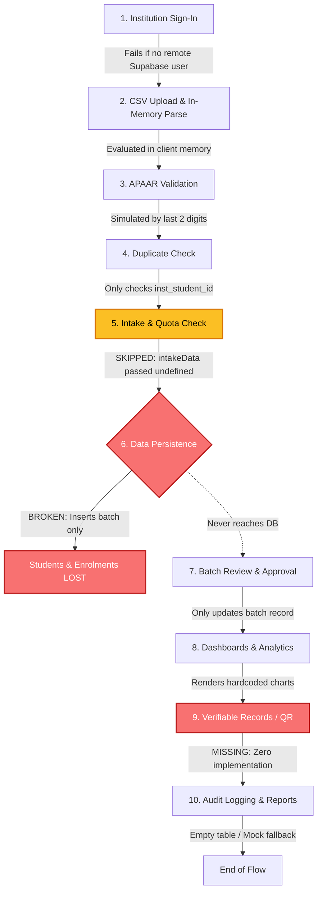
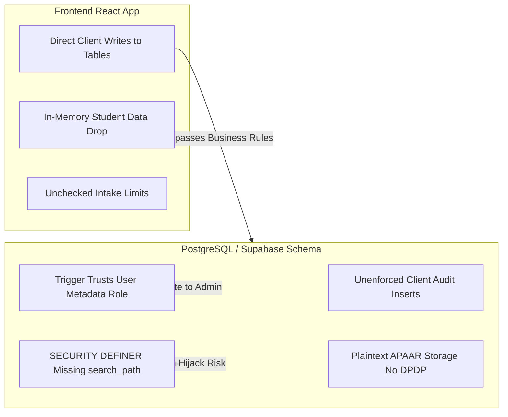
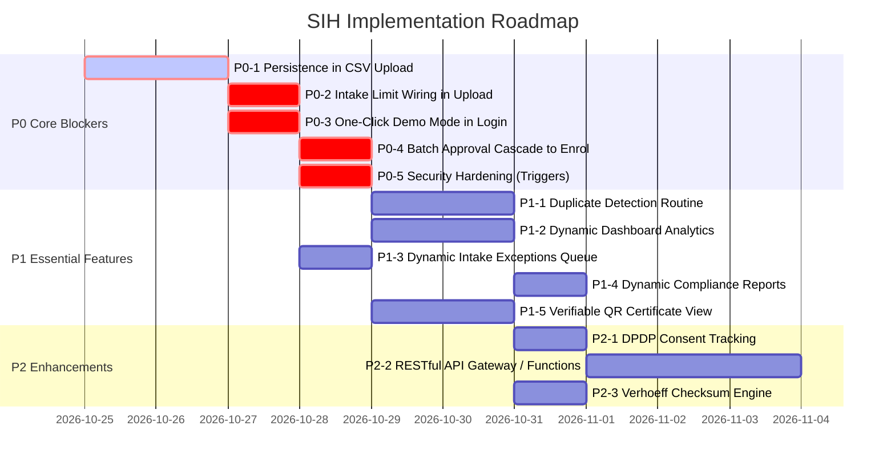

# AICTE–APAAR SIH Prototype: Comprehensive Implementation & Architecture Audit

**Document Status:** OFFICIAL AUDIT REPORT — READ-ONLY STATIC ANALYSIS  
**Repository:** `D:\aicte-apaar-platform`  
**Target Problem Statement:** Smart India Hackathon (SIH) — AICTE–APAAR Student Data Management & Verification Platform  
**Technology Stack:** React 19 + TypeScript + Vite + Supabase (PostgreSQL 15 + PostgREST + GoTrue Auth) + TailwindCSS v4  
**Audit Date:** 2026-10-24  
**Audit Mode:** Strictly Read-Only (No live database connections, no SQL execution, no code modifications)

---

## Executive Summary

A comprehensive static analysis of the AICTE–APAAR Student Data Management and Verification Platform repository was conducted to assess its alignment with the official Smart India Hackathon (SIH) problem statement. The expected end-to-end operational flow is:

$$\text{Institution} \longrightarrow \text{Student Data Upload} \longrightarrow \text{APAAR Validation} \longrightarrow \text{Data Verification} \longrightarrow \text{AICTE Central Repository} \longrightarrow \text{Analytics \& Monitoring} \longrightarrow \text{Authorized Verification}$$

### Primary Audit Findings:
1. **Broken Data Persistence in Core Ingestion Pipeline (Catastrophic Blocker):** While the CSV Upload wizard (`CSVUploadPage.tsx`) successfully parses headers and rows in-memory using PapaParse, **it never inserts parsed student or enrolment records into the PostgreSQL database**. It only inserts/updates a summary row in `submission_batches`. All parsed student records are discarded from React state upon page departure.
2. **Disconnected Intake & Quota Validation:** The business validation engine (`validationEngine.ts`) contains well-structured functions to check approved regular intake and supernumerary caps, but `CSVUploadPage.tsx` invokes `validateCSVRow` with `intakeData = undefined`, `currentRegularCount = 0`, and `currentSupernumeraryCount = 0`. Consequently, intake overflow checks are completely bypassed during uploads.
3. **Pervasive Reliance on Hardcoded Demo Fallbacks:** Every primary dashboard and review screen (`AICTEDashboard.tsx`, `InstitutionDashboard.tsx`, `EnrolmentsPage.tsx`, `SubmissionsPage.tsx`, `DuplicateReviewPage.tsx`, `IntakeExceptionsPage.tsx`, `ReportsPage.tsx`, `AuditLogPage.tsx`, `UsersPage.tsx`) falls back to static hardcoded mock constants when Supabase queries return empty or unconfigured. In fact, `IntakeExceptionsPage.tsx` and `ReportsPage.tsx` make **zero database calls**.
4. **Missing SIH Deliverables (Certificates, QR Verification & API Gateways):** No verifiable certificate generation, student ID + APAAR ID credential display, QR verification endpoints, or student DPDP consent mechanisms exist in the repository. Furthermore, the documented RESTful API (`/api/v1/...` in `ApiDocsPage.tsx` and `openapi.yaml`) is purely documentation; no Express/Vite server or Supabase Edge Functions exist.
5. **False "Instant Demo Mode" Claims:** While `README.md` advertises instant one-click demo login buttons without database setup, `LoginPage.tsx` contains no demo buttons, and `AuthContext.tsx` hardcodes `isDemoMode: false`. Logging in requires an active remote Supabase connection with pre-provisioned user credentials.

---

## A. Requirement Coverage Matrix

Every requirement from the official SIH problem statement was evaluated against static repository evidence.

| SIH Requirement | Status | Key File Paths & Symbols | Static Evidence & Findings |
|---|---|---|---|
| **1. Multi-Tenant Role-Based Access Control (RBAC)** | **Partially Implemented / Runtime Unverified** | `src/contexts/AuthContext.tsx`, `src/pages/auth/LoginPage.tsx`, `src/App.tsx` (`ProtectedRoute`, `RoleRedirect`), `supabase/migrations/001_initial_schema.sql` | Client routes correctly enforce `aicte_admin` vs. `institution_admin`. However, demo buttons promised in `README.md` do not exist in `LoginPage.tsx`. `isDemoMode: false` is hardcoded. Requires active remote Supabase connection. |
| **2. Student-Level CSV Upload & Header Validation** | **Implemented in code — static evidence found** | `src/pages/institution/CSVUploadPage.tsx`, `src/services/validationEngine.ts` (`validateCSVHeaders`, `parseCSVToRows`) | PapaParse parses local CSVs; validates 6 mandatory headers (`institution_student_id`, `full_name`, `programme_code`, `academic_year`, `admission_date`, `admission_category`). |
| **3. APAAR ID Syntax & Identifier Validation** | **Mocked / Simulated** | `src/lib/utils.ts` (`validateApaarFormat`), `src/services/apaarAdapter.ts` (`MockVerificationProvider`, `OfficialApaarProvider`) | Syntax validation checks regex `^\d{12}$`. No Luhn/Verhoeff checksum is implemented. Identity verification is 100% simulated based on last 2 digits. `OfficialApaarProvider` throws an unconfigured error. |
| **4. Approved Intake vs. Actual Enrolment Validation** | **Partially Implemented / Disconnected** | `src/services/validationEngine.ts` (`validateCSVRow`), `src/pages/institution/CSVUploadPage.tsx` (line 74) | Validation logic exists in `validationEngine.ts`, but `CSVUploadPage.tsx` calls it with `intakeData = undefined` and `count = 0`. Intake checks never fire in the UI. No DB constraint/trigger on `enrolments`. |
| **5. Seat Category & Supernumerary Quota Validation** | **Partially Implemented / Disconnected** | `src/services/validationEngine.ts`, `src/types/index.ts` (`SupernumeraryClassification`) | Syntax checks for NRI, OCI, FN, TFWS, KM, PwD exist, but quota limit checks are bypassed because `CSVUploadPage.tsx` passes `currentSupernumeraryCount = 0`. Inconsistencies only generate non-blocking warnings. |
| **6. Duplicate Student Detection (Intra-batch & Historical)** | **Partially Implemented / Incomplete** | `src/services/validationEngine.ts`, `src/pages/institution/CSVUploadPage.tsx`, `supabase/migrations/001_initial_schema.sql` (`duplicate_review_cases`) | Intra-batch and historical duplicate checks exist **only** for `institution_student_id`. APAAR ID duplicate detection within a batch or across institutions is completely missing. No routine populates `duplicate_review_cases`. |
| **7. Central Repository Persistence (Students & Enrolments)** | **Missing in Flow** | `src/pages/institution/CSVUploadPage.tsx` (`processFile`, `handleSubmitBatch`) | **Critical flaw:** Upload wizard only inserts a row into `submission_batches`. Parsed student records are **never** inserted into `students` or `enrolments`. All student data is lost upon page exit. |
| **8. Submission Batch Review & Approval Lifecycle** | **Partially Implemented / Mocked** | `src/pages/shared/SubmissionsPage.tsx` (`handleAction`), `src/types/index.ts` (`BatchStatus`, `SubmissionStatus`) | UI permits AICTE admin to approve/reject/return batches. However, approval only updates `submission_batches.status`; it does not update underlying `enrolments` or write audit logs. Falls back to `DEMO_BATCHES`. |
| **9. Institution Monitoring Dashboard** | **Mocked / Simulated** | `src/pages/institution/InstitutionDashboard.tsx` | Queries 4 scalar counters from Supabase, but programme-wise enrolment breakdown is completely hardcoded (`DEMO_PROGRAMME_DATA`). Falls back to mock data if empty. |
| **10. AICTE Central Supervisory Dashboard** | **Mocked / Simulated** | `src/pages/aicte/AICTEDashboard.tsx` | Only 4 scalar counters query Supabase. All graphical visualizations (`DEMO_ENROLMENT_TREND`, `DEMO_APAAR_PIE`, `DEMO_PROGRAMME_BARS`) are static hardcoded arrays and never reflect real database data. |
| **11. Intake Exceptions Review Queue** | **Mocked / Simulated** | `src/pages/aicte/IntakeExceptionsPage.tsx` | Page contains **zero** database queries. Renders static hardcoded `DEMO_EXCEPTIONS`. No table or database view exists for intake exceptions. |
| **12. Verifiable Credential / Certificate with APAAR & Student ID** | **Missing** | *No file found* | No components, routes, libraries (`qrcode`, `pdf`), or schema tables exist for certificate generation, student credential cards, or QR verification. |
| **13. API Interoperability & Institution ERP Integration** | **Mocked / Documentation Only** | `src/pages/shared/ApiDocsPage.tsx`, `docs/openapi.yaml` | Static UI displays mock OpenAPI documentation and curl examples for `/api/v1/...`. No backend API routes, Express middleware, or Supabase Edge Functions exist. |
| **14. DPDP Privacy, Masking & Student Consent Framework** | **Partially Implemented / Missing** | `src/lib/utils.ts` (`maskApaarId`) | Masking utility exists (`XXXXXXXX1234`). However, student/guardian consent capture, consent timestamps, and DPDP compliance metadata are completely absent from schemas and UI. |
| **15. Immutable Regulatory Audit Trail** | **Partially Implemented / Disconnected** | `src/pages/aicte/AuditLogPage.tsx`, `supabase/migrations/001_initial_schema.sql` (`audit_logs`) | `audit_logs` table exists with append-only RLS, but **zero** frontend components or database triggers write to it. `AuditLogPage.tsx` displays hardcoded `DEMO_AUDIT`. |
| **16. Regulatory Compliance & Analytics Reports** | **Mocked / Simulated** | `src/pages/aicte/ReportsPage.tsx` | Page contains **zero** Supabase queries. Report views and "Export CSV" feature export static hardcoded array `DEMO_INST_ENROLMENTS`. |

---

## B. End-to-End Workflow Assessment

Static code tracing across the ten core operational paths revealed critical functional discontinuities:



### 1. Institution Sign-In
- **Code Path:** `src/pages/auth/LoginPage.tsx` $\rightarrow$ `useAuth().signIn(email, password)` $\rightarrow$ `src/contexts/AuthContext.tsx` $\rightarrow$ `supabase.auth.signInWithPassword()` $\rightarrow$ `fetchProfile(user.id)` $\rightarrow$ `App.tsx:RoleRedirect` $\rightarrow$ `/institution`.
- **Break Points & Discrepancies:**
  - `README.md` claims instant demo logins via one-click buttons, but `LoginPage.tsx` contains no demo buttons whatsoever.
  - `AuthContext.tsx` hardcodes `isDemoMode: false`.
  - Authentication strictly requires an active internet connection to Supabase and pre-existing credentials in `auth.users` and `public.profiles`.
  - No institution self-registration or account onboarding interface exists.

### 2. CSV Upload and File Validation
- **Code Path:** `src/pages/institution/CSVUploadPage.tsx` (`handleFileSelect`, `handleDrop`, `processFile`) $\rightarrow$ `Papa.parse()` $\rightarrow$ `src/services/validationEngine.ts` (`validateCSVHeaders`, `parseCSVToRows`).
- **Break Points & Discrepancies:**
  - Validates mandatory headers and converts CSV data to structured `CSVRow[]` objects in React state.
  - Parsing occurs entirely client-side. Large files (>5,000 rows) will cause UI jank due to synchronous execution.

### 3. APAAR ID Validation
- **Code Path:** `CSVUploadPage.tsx:processFile` $\rightarrow$ `src/services/apaarAdapter.ts:verifyApaarId()` $\rightarrow$ `MockVerificationProvider.verify()`.
- **Break Points & Discrepancies:**
  - Pure simulation. Checks regex `^\d{12}$` via `validateApaarFormat`.
  - Mock outcomes are hardcoded based on last digits (`00` = invalid, `99` = unavailable, last digit `5` = pending, others = verified).
  - Introduces artificial `sleep(300ms - 700ms)` per row sequentially in a `for` loop. For a batch of 100 rows, validation stalls the browser for 30–70 seconds.
  - No checksum algorithm (Verhoeff/Luhn) is verified.
  - `OfficialApaarProvider` is an empty stub that throws an exception.

### 4. Duplicate and Cross-Institution Checks
- **Code Path:** `CSVUploadPage.tsx:processFile` queries `supabase.from("enrolments").select("institution_student_id").eq("institution_id", institutionId)` $\rightarrow$ populates `existingIds` set $\rightarrow$ `validateCSVRow()`.
- **Break Points & Discrepancies:**
  - **Severe Gap:** Duplicate checking is restricted exclusively to `institution_student_id` within the single institution.
  - Duplicate APAAR IDs within the same CSV batch are **not checked**.
  - Duplicate APAAR IDs previously submitted by the same institution are **not checked**.
  - Cross-institution duplicates (same APAAR ID enrolled at another institution) are **completely unchecked**.
  - Database table `duplicate_review_cases` is never populated by any frontend action or database routine.
  - `DuplicateReviewPage.tsx` displays hardcoded mock cases (`DEMO_CASES`).

### 5. Approved-Intake and Seat-Category Validation
- **Code Path:** `src/services/validationEngine.ts:validateCSVRow()`.
- **Break Points & Discrepancies:**
  - **Catastrophic Disconnection:** In `CSVUploadPage.tsx` (line 74), `validateCSVRow` is invoked as:
    ```typescript
    const result = validateCSVRow(row, existingIds, batchStudentIds, undefined, 0, 0);
    ```
  - `intakeData` is passed as `undefined`.
  - `currentRegularCount` is passed as `0`.
  - `currentSupernumeraryCount` is passed as `0`.
  - The capacity overflow checks (`intake_exceeded`, `supernumerary_exceeded`) inside `validationEngine.ts` **never execute**.
  - `IntakeExceptionsPage.tsx` does not query Supabase at all; it renders hardcoded `DEMO_EXCEPTIONS`.

### 6. Student/Enrolment Persistence (The Core Blocker)
- **Code Path:** `CSVUploadPage.tsx:processFile` (lines 84–98) and `handleSubmitBatch` (lines 115–122).
- **Break Points & Discrepancies:**
  - In `processFile`, code inserts a single row into `submission_batches`:
    ```typescript
    await supabase.from("submission_batches").insert({
      institution_id: institutionId,
      academic_year: academicYear,
      status: "draft",
      total_records: rows.length,
      valid_records: validationResults.filter(r => r.is_valid).length,
      error_records: validationResults.filter(r => !r.is_valid).length,
    });
    ```
  - In `handleSubmitBatch`, code only updates the batch status:
    ```typescript
    await supabase.from("submission_batches").update({
      status: "submitted",
      submitted_at: new Date().toISOString()
    }).eq("id", batchId);
    ```
  - **The student and enrolment rows are NEVER written to the database.**
  - Neither `supabase.from("students").insert(...)` nor `supabase.from("enrolments").insert(...)` exists anywhere in `CSVUploadPage.tsx`.
  - Once the user navigates away or refreshes, all parsed student records vanish.

### 7. Batch Review and Approval
- **Code Path:** `src/pages/shared/SubmissionsPage.tsx` $\rightarrow$ `loadBatches()` $\rightarrow$ `ReviewModal` $\rightarrow$ `handleAction()`.
- **Break Points & Discrepancies:**
  - `handleAction` updates `submission_batches.status` (`approved`, `rejected`, `returned_for_correction`) and records `reviewer_notes`.
  - It **does not cascade** the approved status to `enrolments.submission_status` (and since enrolments were never inserted, there are none to update).
  - Does not insert an audit log entry into `audit_logs`.
  - If Supabase is unconfigured or empty, it renders `DEMO_BATCHES` where actions fail silently.

### 8. AICTE and Institution Dashboard Updates
- **Code Path:** `src/pages/aicte/AICTEDashboard.tsx` and `src/pages/institution/InstitutionDashboard.tsx`.
- **Break Points & Discrepancies:**
  - Both dashboards attempt to fetch 4 scalar counts via `select("id", { count: "exact", head: true })`.
  - Because enrolments are never persisted, real database count for enrolments is always 0.
  - All charts (Monthly Trend, APAAR Verification Pie Chart, Programme-wise Enrolment vs Intake Bars) use static hardcoded constant arrays (`DEMO_ENROLMENT_TREND`, `DEMO_APAAR_PIE`, `DEMO_PROGRAMME_BARS`).
  - Charts are completely disconnected from the database.

### 9. Authorized Record Verification
- **Code Path:** Completely missing.
- **Break Points & Discrepancies:**
  - Zero code exists for generating academic certificates, student credential cards, or embedding QR codes.
  - Zero endpoints or pages exist for employers, universities, or students to verify APAAR + Student ID records.

### 10. Audit Logging and Reporting
- **Code Path:** `src/pages/aicte/AuditLogPage.tsx` and `src/pages/aicte/ReportsPage.tsx`.
- **Break Points & Discrepancies:**
  - `AuditLogPage.tsx` queries `supabase.from("audit_logs")`, but because no routine or frontend action ever inserts into `audit_logs`, it always falls back to hardcoded `DEMO_AUDIT`.
  - `ReportsPage.tsx` contains **zero** database queries. Clicking "Export CSV" downloads the hardcoded constant array `DEMO_INST_ENROLMENTS`.

---

## C. Security and Privacy Gap List

Static analysis of the repository files, schema (`001_initial_schema.sql`), and environment configuration revealed seven critical security and privacy gaps:



### 1. Privilege Escalation via User Metadata in Signup Trigger
- **Location:** `supabase/migrations/001_initial_schema.sql` (lines 301–314).
- **Evidence:**
  ```sql
  CREATE OR REPLACE FUNCTION handle_new_user()
  RETURNS TRIGGER LANGUAGE plpgsql SECURITY DEFINER AS $$
  BEGIN
    INSERT INTO profiles (id, email, full_name, role)
    VALUES (
      NEW.id,
      NEW.email,
      COALESCE(NEW.raw_user_meta_data->>'full_name', split_part(NEW.email, '@', 1)),
      COALESCE((NEW.raw_user_meta_data->>'role')::user_role, 'institution_admin')
    )
    ON CONFLICT (id) DO NOTHING;
    RETURN NEW;
  END;
  $$;
  ```
- **Risk:** Any user signing up via Supabase Auth who supplies `"role": "aicte_admin"` in their signup metadata will be assigned the `aicte_admin` role in `public.profiles`, gaining unrestricted administrative control over the entire platform.

### 2. Missing `search_path` on SECURITY DEFINER Helper Routines
- **Location:** `supabase/migrations/001_initial_schema.sql` (lines 339–347).
- **Evidence:**
  ```sql
  CREATE OR REPLACE FUNCTION current_user_role()
  RETURNS user_role LANGUAGE SQL SECURITY DEFINER STABLE AS $$
    SELECT role FROM profiles WHERE id = auth.uid();
  $$;

  CREATE OR REPLACE FUNCTION current_user_institution_id()
  RETURNS UUID LANGUAGE SQL SECURITY DEFINER STABLE AS $$
    SELECT institution_id FROM profiles WHERE id = auth.uid();
  $$;
  ```
- **Risk:** Both functions are marked `SECURITY DEFINER` but lack `SET search_path = pg_catalog`. If an attacker creates a malicious object in a search path preceding `pg_catalog` or `public`, code execution hijacking is possible.

### 3. Client-Side Audit Trail Forgery & Lack of Trigger Enforcement
- **Location:** `supabase/migrations/001_initial_schema.sql` (line 405) and `src/pages/aicte/AuditLogPage.tsx`.
- **Evidence:**
  ```sql
  CREATE POLICY "Authenticated: insert audit logs" ON audit_logs 
    FOR INSERT WITH CHECK (auth.uid() IS NOT NULL);
  ```
- **Risk:** Any authenticated client can submit arbitrary rows to `audit_logs` with forged actor roles, falsified timestamps, and arbitrary entity IDs. Conversely, genuine administrative mutations (batch approvals, duplicate dismissals, institution edits) are not captured by database triggers.

### 4. Over-Permissive Table Grants & Direct Client Writes
- **Location:** `supabase/migrations/001_initial_schema.sql` and `src/pages/aicte/InstitutionsPage.tsx`.
- **Evidence:**
  `001_initial_schema.sql` contains zero `REVOKE` statements for the `authenticated` role on tables. In `InstitutionsPage.tsx`:
  ```typescript
  await supabase.from("institutions").insert({ ...form });
  await supabase.from("institutions").update({ ...form }).eq("id", institution.id);
  ```
- **Risk:** Frontend clients execute direct `INSERT` and `UPDATE` statements against core relational tables rather than interacting through validated, audited stored procedures or backend edge functions.

### 5. Absence of Student Consent Tracking (DPDP Act 2023 Non-Compliance)
- **Location:** `supabase/migrations/001_initial_schema.sql` (`students` table) and `src/types/index.ts`.
- **Evidence:**
  The `students` table stores `apaar_id`, `full_name`, `date_of_birth`, and `gender`, but contains no fields for:
  - Student or parent/guardian consent flag (`consent_obtained`).
  - Consent capture timestamp and consent channel.
  - Consent withdrawal status.
- **Risk:** Storing and verifying academic identifiers without verifiable consent violates India's Digital Personal Data Protection (DPDP) Act 2023 mandates for educational data processing.

### 6. Plaintext Storage of Academic Identifiers
- **Location:** `supabase/migrations/001_initial_schema.sql` (`students.apaar_id VARCHAR(12)`).
- **Evidence:** While `maskApaarId` masks the identifier in UI views, the underlying database stores 12-digit APAAR IDs in plaintext without hashing, salt, or column-level access controls.

### 7. Active Supabase Credentials Committed in `.env`
- **Location:** `D:\aicte-apaar-platform\.env`.
- **Evidence:** `.env` contains an active remote Supabase project URL and anon JWT key. While anon keys are intended to be public in Supabase architectures when protected by RLS, committing environment files to source control represents an operational hygiene vulnerability.

---

## D. SIH Demo Readiness Assessment

### Overall Classification:
$$\mathbf{NOT\;YET\;DEMONSTRABLE\;END\;TO\;END}$$
*(Can only be shown as a partially mocked visual mockup with disconnected screens)*

### Detailed Evaluation:
1. **Core Workflow Blocked:** An evaluator attempting to upload a CSV file will see validation success, but the students will never appear in `EnrolmentsPage.tsx`, will never appear in `SubmissionsPage.tsx` for AICTE review, and will never reflect in dashboard enrolment counts.
2. **Login Requires Manual Setup:** An evaluator opening `http://localhost:5173/login` will not find the demo login buttons described in `README.md`. Unless they possess valid credentials for the remote Supabase project, they cannot log in.
3. **Synthetic Screens:** `IntakeExceptionsPage.tsx`, `ReportsPage.tsx`, and all dashboard charts are 100% static mockups.
4. **Conclusion:** The project possesses an attractive UI and solid validation logic in isolation, but the architectural glue between the frontend and database is disconnected.

---

## E. Prioritized Implementation Backlog



### Priority 0: Essential Blockers to Core Demo & Security Boundaries

#### P0-1: Implement End-to-End Student & Enrolment Data Persistence in CSV Upload
- **Target Files:** `src/pages/institution/CSVUploadPage.tsx`, `src/types/index.ts`
- **Dependencies:** None.
- **Acceptance Criteria:**
  - Upon clicking "Submit Valid Records", the system performs a multi-row transaction or sequential batch insert inserting students into `public.students` (handling conflict on `apaar_id` / `id`) and enrolments into `public.enrolments` linked to `submission_batches.id`.
  - Enrolment rows must be created with `submission_status = 'submitted'` and `enrolment_status = 'active'`.
  - Invalid rows must be recorded in `public.submission_errors`.
- **Suggested Verification Test:** Upload `test_students.csv` (5 rows). Verify via Supabase client that 5 rows exist in `enrolments` and appear immediately in `EnrolmentsPage.tsx`.

#### P0-2: Connect Approved Intake & Supernumerary Quota Validation in CSV Upload
- **Target Files:** `src/pages/institution/CSVUploadPage.tsx`, `src/services/validationEngine.ts`
- **Dependencies:** P0-1.
- **Acceptance Criteria:**
  - In `CSVUploadPage.tsx:processFile`, fetch the active `approved_intakes` record for the institution and programme matching `academic_year`.
  - Query existing approved/submitted enrolments count for that programme.
  - Pass the real `intakeData` and current counts into `validateCSVRow`.
  - Flag any student exceeding approved regular intake or supernumerary quotas with `intake_exceeded` or `supernumerary_exceeded`.
- **Suggested Verification Test:** Upload 15 rows for a programme with approved intake of 10. Verify rows 11–15 are flagged with `intake_exceeded` error.

#### P0-3: Implement Instant One-Click Demo Mode & Role Switcher in Login
- **Target Files:** `src/pages/auth/LoginPage.tsx`, `src/contexts/AuthContext.tsx`
- **Dependencies:** None.
- **Acceptance Criteria:**
  - Add "AICTE Admin Demo" and "Institution Admin Demo" buttons to `LoginPage.tsx` as documented in `README.md`.
  - In `AuthContext.tsx`, implement an offline/mock session state when demo buttons are clicked, allowing judges to evaluate the entire platform without configuring remote Supabase credentials.
- **Suggested Verification Test:** Disconnect internet or clear Supabase keys; click "AICTE Admin Demo"; verify dashboard loads without authentication error.

#### P0-4: Implement Batch Review State Cascade to Enrolments & Transactional Audit Logging
- **Target Files:** `src/pages/shared/SubmissionsPage.tsx`, `supabase/migrations/001_initial_schema.sql`
- **Dependencies:** P0-1.
- **Acceptance Criteria:**
  - When AICTE Admin approves a batch, atomically update all associated `enrolments.submission_status = 'approved'`.
  - Automatically record an audit log entry in `audit_logs` capturing the action, actor ID, batch ID, and timestamp.
- **Suggested Verification Test:** Approve batch in `SubmissionsPage.tsx`. Check `EnrolmentsPage.tsx` to verify student badges transition from "Submitted" to "Approved".

#### P0-5: Harden Database Signup Trigger & Function Search Paths
- **Target Files:** `supabase/migrations/001_initial_schema.sql`
- **Dependencies:** None.
- **Acceptance Criteria:**
  - Update `handle_new_user()` so that `role` is always defaulted to `institution_admin`; prohibit setting `aicte_admin` via `raw_user_meta_data`.
  - Add `SET search_path = pg_catalog` to `current_user_role()` and `current_user_institution_id()`.
- **Suggested Verification Test:** Create user with `raw_user_meta_data = { "role": "aicte_admin" }`. Verify profile role is created as `institution_admin`.

---

### Priority 1: Essential SIH Features (Workflow Completeness)

#### P1-1: Automated Duplicate Detection Engine (Intra-Batch & Cross-Institution)
- **Target Files:** `src/services/validationEngine.ts`, `src/pages/institution/CSVUploadPage.tsx`, `src/pages/aicte/DuplicateReviewPage.tsx`
- **Dependencies:** P0-1.
- **Acceptance Criteria:**
  - Check for duplicate APAAR IDs within the batch and across previously enrolled students at other institutions.
  - Insert detected cross-institution collisions into `duplicate_review_cases`.
  - Allow AICTE Admin on `DuplicateReviewPage.tsx` to resolve cases and update enrolment status.
- **Suggested Verification Test:** Upload student with APAAR `123456789012` at Institution A. Upload same APAAR at Institution B. Verify a new pending case appears in `DuplicateReviewPage.tsx`.

#### P1-2: Dynamic Dashboard Metrics & Chart Data Binding
- **Target Files:** `src/pages/aicte/AICTEDashboard.tsx`, `src/pages/institution/InstitutionDashboard.tsx`
- **Dependencies:** P0-1.
- **Acceptance Criteria:**
  - Replace static arrays (`DEMO_ENROLMENT_TREND`, `DEMO_APAAR_PIE`, `DEMO_PROGRAMME_BARS`) with aggregate SQL queries or dynamic calculations over `enrolments` and `approved_intakes`.
- **Suggested Verification Test:** Upload and approve 20 students. Verify AICTE Dashboard pie chart and total enrolments increase dynamically.

#### P1-3: Dynamic Intake Exceptions Queue & Resolution Workflow
- **Target Files:** `src/pages/aicte/IntakeExceptionsPage.tsx`, `src/pages/institution/CSVUploadPage.tsx`
- **Dependencies:** P0-2.
- **Acceptance Criteria:**
  - Query programmes where current enrolments exceed approved intake. Display active exceptions dynamically.
- **Suggested Verification Test:** Force an intake overflow; verify the overflow appears on `IntakeExceptionsPage.tsx`.

#### P1-4: Dynamic Compliance Reports & Real CSV Export
- **Target Files:** `src/pages/aicte/ReportsPage.tsx`
- **Dependencies:** P0-1.
- **Acceptance Criteria:**
  - Compute real enrolment summaries grouped by institution, programme, and admission category.
  - "Export CSV" generates CSV with actual database records.
- **Suggested Verification Test:** Export report and verify downloaded CSV matches database counts.

#### P1-5: Verifiable Academic Credential / Certificate View with QR Code
- **Target Files:** New component `src/components/shared/StudentCertificateModal.tsx`, `src/pages/institution/EnrolmentsPage.tsx`
- **Dependencies:** P0-1.
- **Acceptance Criteria:**
  - Provide a "View Certificate" button on approved enrolments.
  - Display a certificate displaying Student Name, Student ID, masked APAAR ID (`XXXXXXXX1234`), Programme, Academic Year, and AICTE approval seal.
  - Render a verifiable QR code containing cryptographic verification URL / payload.
- **Suggested Verification Test:** Click "View Certificate" on approved student; verify modal displays APAAR ID, Student ID, and scannable QR code.

---

### Priority 2: Enhancements & Regulatory Expansion

#### P2-1: Student Consent Capture & DPDP Compliance Metadata
- **Target Files:** `src/types/index.ts`, `supabase/migrations/001_initial_schema.sql`, `src/pages/institution/CSVUploadPage.tsx`
- **Acceptance Criteria:** Include `consent_obtained` and `consent_date` in CSV upload template and database schema.

#### P2-2: Real RESTful API Gateway / Supabase Edge Functions for Institution ERPs
- **Target Files:** `supabase/functions/`, `docs/openapi.yaml`
- **Acceptance Criteria:** Implement endpoints matching `openapi.yaml` (`GET /institutions/{id}/programmes`, `POST /batches/submit`) with bearer authentication.

#### P2-3: Verhoeff Checksum Algorithm Implementation
- **Target Files:** `src/lib/utils.ts`, `src/services/apaarAdapter.ts`
- **Acceptance Criteria:** Implement standard Verhoeff checksum validation for Indian national identifiers to catch digit transposition errors.

---

## F. Recommended First Implementation Task

### Selected Task:
$$\mathbf{P0\text{-}1:\;Implement\;End\text{-}to\text{-}End\;Student\;\&\;Enrolment\;Data\;Persistence\;in\;CSV\;Upload\;Wizard}$$

### Rationale:
Task **P0-1** is the single greatest architectural bottleneck in the entire project. Currently, the platform stops functioning after parsing the CSV file:
1. Because no student or enrolment records are written to PostgreSQL, the Central AICTE Repository remains completely empty.
2. The AICTE Admin review screen (`SubmissionsPage.tsx`) cannot inspect individual student records.
3. The Institution Enrolments view (`EnrolmentsPage.tsx`) has no database rows to fetch and is forced to display mock data.
4. All dashboard charts, intake exception counters, and duplicate detection routines have no underlying data to evaluate.
5. Verifiable certificates cannot be generated because records do not persist.

Implementing P0-1 creates the fundamental database foundation upon which all other SIH requirements rely.

### Verification Plan:
1. **Pre-test State:** Verify database tables `students` and `enrolments` are empty or queryable.
2. **Execution:** Author the batch persistence logic in `CSVUploadPage.tsx` to insert valid student records into `students` and create corresponding rows in `enrolments` referencing the generated `batch_id`.
3. **Post-test Verification:**
   - Upload a test CSV with 5 students.
   - Confirm via Supabase query that 5 records exist in `students` and 5 records exist in `enrolments` with status `submitted`.
   - Open `EnrolmentsPage.tsx` and verify that the 5 newly uploaded students are displayed dynamically.
   - Open `SubmissionsPage.tsx` as an AICTE Admin and confirm the submission batch accurately reflects the 5 student records.
