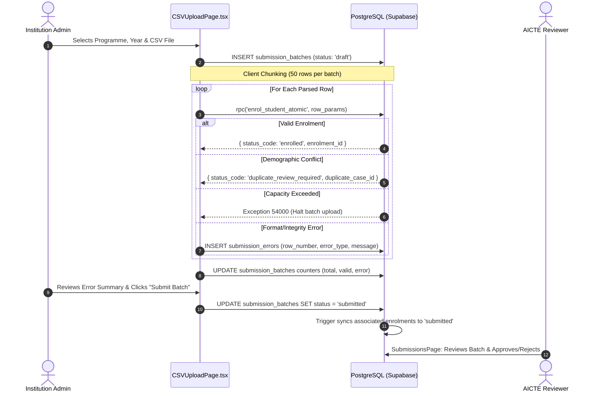

# AICTE–APAAR Student Data Management Platform
## CSV Submission & Enrolment Workflow Specification (v11.1)
**Document Status:** OFFICIAL REVIEW ARTIFACT  
**Repository:** `D:\aicte-apaar-platform`  
**Target Code:** `src/pages/institution/CSVUploadPage.tsx`, `src/pages/shared/SubmissionsPage.tsx`  

---

## 1. Executive Summary & Existing Disconnect

Static inspection of `src/pages/institution/CSVUploadPage.tsx` confirms:
- The existing frontend parses CSV files with PapaParse in the browser.
- It validates headers, required strings, and basic regex client-side.
- It inserts a `submission_batches` row with `status = 'draft'`.
- **THE DISCONNECT:** It displays validation results in a table, but **never inserts student or enrolment records into PostgreSQL**.
- When the user clicks "Submit Batch", it simply executes:
  ```typescript
  await supabase.from("submission_batches").update({ status: "submitted", submitted_at: new Date().toISOString() }).eq("id", batchId);
  ```
  This leaves the database batch record completely empty (`total_records: 0`, `valid_records: 0`, zero rows in `enrolments`).

v11.1 defines the complete, resilient end-to-end workflow to bridge this gap.

---

## 2. Transaction Architecture: Row-Level Commits vs. All-or-Nothing

### Transaction Decision: Row-Level Commits with Structured Outcome (CHOSEN)
In institutional admissions, CSV files contain between 500 and 5,000 student records. 

| Evaluation Metric | All-or-Nothing (Single Giant Transaction) | Row-Level Commits (v11.1 Architecture) |
|---|---|---|
| **Lock Contention** | Holds row locks on `approved_intakes` and `submission_batches` for several minutes. Starves concurrent uploads. | Holds locks for < 30ms per row. Minimal lock contention. |
| **Timeout Vulnerability** | Guaranteed failure on large batches due to PostgREST 8-second HTTP statement timeout. | Chunked parallel or sequential RPC calls stay well below timeout limits. |
| **Error Blast Radius** | A single typographical error on row 4,999 aborts all 4,998 valid enrolments. | Valid rows commit successfully. Erroneous rows are isolated in `submission_errors`. |
| **Network Resilience** | Disconnection aborts entire batch; user must re-upload entire file. | Upload can be resumed or retried idempotently from the failed row. |

### Architecture Rule
**Row-level commits are mandatory.** Each valid row is committed independently via `enrol_student_atomic()`. Invalid rows insert structured diagnostics into `public.submission_errors`.

---

## 3. The 10-Stage Enrolment Lifecycle



---

## 4. Idempotency & Network Failure Recovery

### Deduplication Invariants
- `enrolments` enforces:
  1. `UNIQUE (institution_id, institution_student_id, academic_year)`
  2. `CONSTRAINT no_duplicate_enrolment UNIQUE (student_id, institution_id, programme_id, academic_year)`

### Client Timeout / Disconnect Scenario
If an HTTP request commits an enrolment in PostgreSQL but the network drops before the browser receives the response:
1. When the user retries the upload, `enrol_student_atomic` executes:
   ```sql
   ON CONFLICT (institution_id, institution_student_id, academic_year)
   DO UPDATE SET updated_at = NOW()
   RETURNING id INTO v_enrolment_id;
   ```
2. The procedure recognizes the existing student and enrolment, returns the existing `enrolment_id` with code `'enrolled'`, and increments the batch counter without creating duplicate records.

---

## 5. Frontend Integration API Contract for `CSVUploadPage.tsx`

```typescript
// Proposed Implementation Contract for src/pages/institution/CSVUploadPage.tsx

interface EnrolmentResult {
  enrolment_id: string | null;
  student_id: string | null;
  duplicate_case_id: string | null;
  status_code: 'enrolled' | 'duplicate_review_required';
  message: string;
}

export const processCsvRow = async (
  row: ParsedStudentRow,
  batchId: string,
  institutionId: string,
  programmeId: string,
  academicYear: string
): Promise<{ success: boolean; flagged?: boolean; error?: string }> => {
  try {
    const { data, error } = await supabase.rpc('enrol_student_atomic', {
      p_institution_id: institutionId,
      p_programme_id: programmeId,
      p_academic_year: academicYear,
      p_batch_id: batchId,
      p_institution_student_id: row.institution_student_id.trim(),
      p_full_name: row.full_name.trim(),
      p_date_of_birth: row.dob,
      p_gender: row.gender,
      p_candidate_apaar_id: row.apaar_id ? row.apaar_id.trim() : null
    });

    if (error) {
      if (error.code === '54000') throw new Error('INTAKE_CAPACITY_EXCEEDED');
      // Record in submission_errors
      await supabase.from('submission_errors').insert({
        batch_id: batchId,
        row_number: row.row_number,
        institution_student_id: row.institution_student_id,
        error_type: 'invalid_format',
        error_message: error.message
      });
      return { success: false, error: error.message };
    }

    const res = data as EnrolmentResult;
    if (res.status_code === 'duplicate_review_required') {
      return { success: true, flagged: true };
    }

    return { success: true };
  } catch (err: any) {
    return { success: false, error: err.message };
  }
};
```
