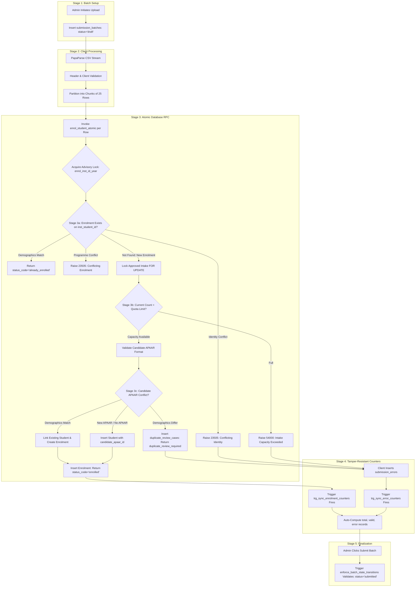

# AICTE–APAAR Student Data Management Platform
## End-to-End CSV Processing & Enrolment Contract (v11.3)
**Document Status:** OFFICIAL WORKFLOW & API CONTRACT  
**Repository:** `D:\aicte-apaar-platform`  
**Review Date:** 2026-10-24  

---

## 1. Architectural Separation: Proposed SQL vs. Unimplemented Frontend

> [!IMPORTANT]
> **Status Declaration:**  
> The database procedures, triggers, and types defined in this document represent the **PROPOSED DATABASE CONTRACT (v11.3)**.  
> The frontend source code at `src/pages/institution/CSVUploadPage.tsx` currently uses legacy direct table inserts. **NO FRONTEND CODE HAS BEEN MODIFIED IN THE ACTIVE REPOSITORY.**  
> Section 6 of this document defines the exact TypeScript code modifications required when a dedicated frontend staging branch is opened.

---

## 2. The Resilient 10-Stage CSV Workflow

The diagram below illustrates the end-to-end lifecycle of student record ingestion, idempotency pre-checking, candidate APAAR resolution, tamper-proof counter synchronization, and duplicate review routing:



---

## 3. Detailed Stage Contracts

### Stage 1: Batch Initialization
1. The institutional administrator navigates to `/institution/csv-upload`.
2. The client queries `programmes` and `approved_intakes` to populate dropdown selectors.
3. When the user selects a programme and academic year, the client creates a record in `public.submission_batches`:
   ```typescript
   const { data: batch, error } = await supabase
     .from('submission_batches')
     .insert({
       institution_id: currentInstitutionId,
       programme_id: selectedProgrammeId,
       academic_year: selectedAcademicYear,
       batch_name: `Upload_${selectedProgrammeCode}_${Date.now()}`,
       status: 'draft',
       total_records: 0,
       valid_records: 0,
       error_records: 0
     })
     .select()
     .single();
   ```

### Stage 2: Client-Side Chunking & Header Validation
1. CSV files are parsed using `papaparse` in streaming chunks.
2. Required headers:
   - `institution_student_id` (Mandatory string, e.g., `"CS-2026-001"`)
   - `full_name` (Mandatory string, e.g., `"Aarav Sharma"`)
   - `date_of_birth` (Mandatory ISO date string, e.g., `"2004-05-15"`)
   - `gender` (Mandatory string, e.g., `"male"`, `"female"`, `"other"`)
   - `candidate_apaar_id` (Optional string, 12 numeric digits)
3. Rows are grouped into chunks of **25 rows** to prevent client HTTP gateway timeouts and avoid excessive lock contention.

### Stage 3: Atomic Enrolment Contract (`enrol_student_atomic`)

#### 3.1 Serialization & Advisory Lock
To prevent concurrent uploads or browser network retries from racing and throwing unhandled duplicate key exceptions, the transaction acquires a transaction-scoped advisory lock:
```sql
PERFORM pg_advisory_xact_lock(hashtext('enrol_' || p_institution_id::text || '_' || p_institution_student_id || '_' || p_academic_year));
```

#### 3.2 Pre-Capacity Idempotency Check (Defect F-11.3-01 Resolution)
Before locking intake capacity or creating candidate records, the procedure inspects existing enrolments:
```sql
SELECT id, student_id, programme_id, enrolment_status
INTO v_existing_enrolment_id, v_existing_student_id, v_existing_prog_id, v_existing_enrol_status
FROM public.enrolments
WHERE institution_id = p_institution_id
  AND institution_student_id = p_institution_student_id
  AND academic_year = p_academic_year;

IF FOUND THEN
  IF v_existing_prog_id = p_programme_id THEN
    SELECT full_name, date_of_birth INTO v_existing_name, v_existing_dob
    FROM public.students WHERE id = v_existing_student_id;

    IF lower(trim(v_existing_name)) = lower(trim(p_full_name)) AND 
       (v_existing_dob IS NULL OR v_existing_dob = p_date_of_birth) THEN
      -- Deterministic Idempotent Retry: Return existing enrolment cleanly
      v_res.enrolment_id := v_existing_enrolment_id;
      v_res.student_id := v_existing_student_id;
      v_res.duplicate_case_id := NULL;
      v_res.status_code := 'already_enrolled';
      v_res.message := 'Idempotent retry: student already enrolled in programme.';
      RETURN v_res;
    ELSE
      RAISE EXCEPTION 'Conflicting identity: institution_student_id % belongs to a student with different demographics', p_institution_student_id
        USING ERRCODE = '23505';
    END IF;
  ELSE
    RAISE EXCEPTION 'Conflicting enrolment: institution_student_id % already enrolled in a different programme', p_institution_student_id
      USING ERRCODE = '23505';
  END IF;
END IF;
```

#### 3.3 Intake Limit Locking & Quota Evaluation
Only if the enrolment does not exist, the procedure locks the intake quota row:
```sql
SELECT approved_intake INTO v_intake_limit
FROM public.approved_intakes
WHERE institution_id = p_institution_id
  AND programme_id = p_programme_id
  AND academic_year = p_academic_year
FOR UPDATE;

SELECT COUNT(*) INTO v_current_count
FROM public.enrolments
WHERE institution_id = p_institution_id
  AND programme_id = p_programme_id
  AND academic_year = p_academic_year
  AND enrolment_status = 'active'::public.enrolment_status
  AND submission_status != 'rejected'::public.submission_status;

IF v_current_count >= v_intake_limit THEN
  RAISE EXCEPTION 'Intake capacity exceeded: current count % meets approved limit %',
    v_current_count, v_intake_limit
    USING ERRCODE = '54000';
END IF;
```

#### 3.4 Candidate APAAR Validation & Duplicate Review Case Routing
```sql
IF p_candidate_apaar_id IS NOT NULL AND trim(p_candidate_apaar_id) != '' THEN
  -- Two-stage regex validation
  IF trim(p_candidate_apaar_id) !~ '^[0-9\s\-]+$' THEN
    RAISE EXCEPTION 'Invalid APAAR format: identifier contains forbidden characters'
      USING ERRCODE = '22023';
  END IF;

  v_norm_apaar := regexp_replace(trim(p_candidate_apaar_id), '[^0-9]', '', 'g');
  IF length(v_norm_apaar) != 12 THEN
    RAISE EXCEPTION 'Invalid APAAR format: identifier must be exactly 12 numeric digits'
      USING ERRCODE = '22023';
  END IF;

  PERFORM pg_advisory_xact_lock(hashtext('candidate_apaar_' || v_norm_apaar));

  SELECT id, full_name, date_of_birth
  INTO v_student_id, v_existing_name, v_existing_dob
  FROM public.students
  WHERE apaar_id = v_norm_apaar OR candidate_apaar_id = v_norm_apaar
  LIMIT 1;

  IF FOUND THEN
    IF lower(trim(v_existing_name)) != lower(trim(p_full_name)) OR 
       (v_existing_dob IS NOT NULL AND v_existing_dob != p_date_of_birth) THEN
      
      -- Insert candidate student record without APAAR
      INSERT INTO public.students (full_name, date_of_birth, gender, candidate_apaar_id, apaar_id, apaar_verification_status, created_at, updated_at)
      VALUES (p_full_name, p_date_of_birth, p_gender, NULL, NULL, 'unverified'::public.apaar_verification_status, NOW(), NOW())
      RETURNING id INTO v_candidate_student_id;

      -- Create Duplicate Review Case
      INSERT INTO public.duplicate_review_cases (
        batch_id,
        student_id_1,
        student_id_2,
        detection_reason,
        review_status,
        created_at
      ) VALUES (
        p_batch_id,
        v_student_id,
        v_candidate_student_id,
        'ERR_DEMOGRAPHIC_MISMATCH: submitted name/DOB differs from registered record',
        'pending'::public.duplicate_review_status,
        NOW()
      )
      RETURNING id INTO v_case_id;

      v_res.enrolment_id := NULL;
      v_res.student_id := v_candidate_student_id;
      v_res.duplicate_case_id := v_case_id;
      v_res.status_code := 'duplicate_review_required';
      v_res.message := 'Identity conflict detected: submitted demographics do not match registered record. Routed to duplicate review.';
      RETURN v_res;
    END IF;
  ELSE
    INSERT INTO public.students (full_name, date_of_birth, gender, candidate_apaar_id, apaar_id, apaar_verification_status, created_at, updated_at)
    VALUES (p_full_name, p_date_of_birth, p_gender, v_norm_apaar, NULL, 'unverified'::public.apaar_verification_status, NOW(), NOW())
    RETURNING id INTO v_student_id;
  END IF;
ELSE
  INSERT INTO public.students (full_name, date_of_birth, gender, candidate_apaar_id, apaar_id, apaar_verification_status, created_at, updated_at)
  VALUES (p_full_name, p_date_of_birth, p_gender, NULL, NULL, 'unverified'::public.apaar_verification_status, NOW(), NOW())
  RETURNING id INTO v_student_id;
END IF;
```

---

## 4. Batch Counter Integrity & Tampering Protection

In v11.3, record counters (`total_records`, `valid_records`, `error_records`) are maintained exclusively by database triggers:
```sql
CREATE OR REPLACE FUNCTION public.sync_batch_record_counters()
RETURNS trigger
LANGUAGE plpgsql
SECURITY DEFINER
SET search_path = pg_catalog, public
AS $$
DECLARE
  v_batch_id uuid;
BEGIN
  v_batch_id := COALESCE(NEW.batch_id, OLD.batch_id);
  IF v_batch_id IS NULL THEN RETURN NEW; END IF;

  UPDATE public.submission_batches
  SET valid_records = (
        SELECT COUNT(*) FROM public.enrolments 
        WHERE batch_id = v_batch_id
      ),
      error_records = (
        SELECT COUNT(*) FROM public.submission_errors 
        WHERE batch_id = v_batch_id
      ),
      total_records = (
        (SELECT COUNT(*) FROM public.enrolments WHERE batch_id = v_batch_id) +
        (SELECT COUNT(*) FROM public.submission_errors WHERE batch_id = v_batch_id)
      ),
      updated_at = NOW()
  WHERE id = v_batch_id;

  RETURN NEW;
END;
$$;
```

Clients have `UPDATE` access revoked on counter columns, preventing tampering or fabrication of batch progress.

---

## 5. Duplicate-Review Navigation Workflow

When `enrol_student_atomic` returns `status_code = 'duplicate_review_required'`:
1. The client logs the event to `submission_errors`:
   ```typescript
   await supabase.from('submission_errors').insert({
     batch_id: batchId,
     row_number: rowIdx + 1,
     error_field: 'candidate_apaar_id',
     error_message: `Demographic conflict on APAAR ${row.candidate_apaar_id}. Case ${result.duplicate_case_id} created.`,
     raw_data: row
   });
   ```
2. In the UI, the upload summary table renders a clickable link directly to `/institution/duplicate-review/${result.duplicate_case_id}`.
3. Because `duplicate_cases_select` is scoped by `batch_id -> submission_batches.institution_id`, the institutional administrator can view their pending case immediately.
4. AICTE administrators review the case in the AICTE Portal and resolve it by either:
   - Confirming the student is distinct (assigning a new verified identity).
   - Merging the record into the existing student.
   - Rejecting the submission as fraudulent.

---

## 6. Proposed Frontend Implementation (`CSVUploadPage.tsx`)

When approved for frontend staging implementation, replace the submission loop in `src/pages/institution/CSVUploadPage.tsx` with the following hardened chunked execution logic:

```typescript
// PROPOSED IMPLEMENTATION FOR src/pages/institution/CSVUploadPage.tsx
const CHUNK_SIZE = 25;

async function processCSVChunks(
  rows: CSVRow[],
  batchId: string,
  institutionId: string,
  programmeId: string,
  academicYear: string
) {
  let processedCount = 0;
  let alreadyEnrolledCount = 0;
  let duplicateCaseCount = 0;
  let errorCount = 0;

  for (let i = 0; i < rows.length; i += CHUNK_SIZE) {
    const chunk = rows.slice(i, i + CHUNK_SIZE);
    
    await Promise.all(
      chunk.map(async (row, index) => {
        const rowNumber = i + index + 1;
        try {
          const { data, error } = await supabase.rpc('enrol_student_atomic', {
            p_institution_id: institutionId,
            p_programme_id: programmeId,
            p_academic_year: academicYear,
            p_batch_id: batchId,
            p_institution_student_id: row.institution_student_id.trim(),
            p_full_name: row.full_name.trim(),
            p_date_of_birth: row.date_of_birth,
            p_gender: row.gender.toLowerCase().trim(),
            p_candidate_apaar_id: row.candidate_apaar_id?.trim() || null
          });

          if (error) throw error;

          if (data.status_code === 'already_enrolled') {
            alreadyEnrolledCount++;
          } else if (data.status_code === 'duplicate_review_required') {
            duplicateCaseCount++;
            await supabase.from('submission_errors').insert({
              batch_id: batchId,
              row_number: rowNumber,
              error_field: 'candidate_apaar_id',
              error_message: `Demographics differ from existing APAAR record. Duplicate Case: ${data.duplicate_case_id}`,
              raw_data: row
            });
          } else if (data.status_code === 'enrolled') {
            processedCount++;
          }
        } catch (err: any) {
          errorCount++;
          await supabase.from('submission_errors').insert({
            batch_id: batchId,
            row_number: rowNumber,
            error_field: 'general',
            error_message: err.message || 'Unknown database error',
            raw_data: row
          });
        }
      })
    );
  }

  return { processedCount, alreadyEnrolledCount, duplicateCaseCount, errorCount };
}
```
