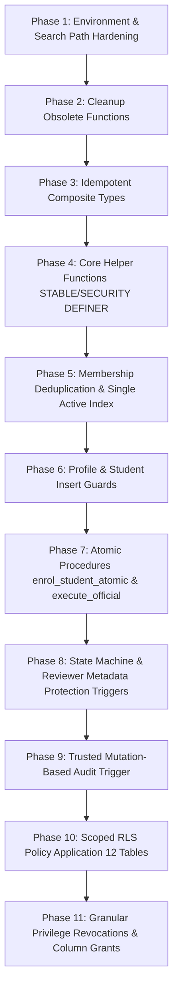

# AICTE–APAAR Student Data Management Platform
## Migration & Deployment Engineering Plan (v11)
**Document Status:** PROPOSAL / REVIEW ONLY — NOT FOR DIRECT EXECUTION  
**Target Migration:** `supabase/migrations/002_rls_security_hardening.sql`  
**Target Staging Database:** PostgreSQL 15+ / Supabase  

---

## 1. Migration Dependencies & Execution Ordering

The v11 remediation migration is engineered with strict topological ordering to prevent broken references or failed constraints during execution:



---

## 2. Preflight Verification Checklist (Staging Gate 1)

Before executing the migration in any environment, run the diagnostic queries from Deliverable 5 of the specification. The following gates must be satisfied:

- [ ] **Gate 1.1 (Environment Check):** Verify connected database is staging:
  ```sql
  SELECT current_database(), current_user, inet_server_addr();
  ```
  Ensure database name is NOT production.
- [ ] **Gate 1.2 (Active Membership Uniqueness):** Query duplicate active memberships:
  ```sql
  SELECT profile_id, COUNT(*) FROM public.institution_memberships 
  WHERE is_active = true GROUP BY profile_id HAVING COUNT(*) > 1;
  ```
  Must return **0 rows** (or confirm automated deduplication in Section 5 of migration is approved to resolve existing rows).
- [ ] **Gate 1.3 (Enum Alignment):** Verify existing enums match expected baseline:
  - `apaar_verification_status` contains `'verified'`, `'unverified'`, `'pending'`, `'invalid'`, `'unavailable'`.
  - `user_role` contains `'aicte_admin'`, `'institution_admin'`.
- [ ] **Gate 1.4 (Verified Backup):** Complete full pre-migration snapshot (schema + data + privileges).

---

## 3. Complete Proposed Migration SQL (`002_rls_security_hardening.sql`)

```sql
-- =============================================================================
-- PROPOSED MIGRATION DRAFT (v11) — DO NOT EXECUTE DIRECTLY
-- File: supabase/migrations/002_rls_security_hardening.sql
-- Description: AICTE–APAAR Database Security Remediation Specification v11
-- Minimum Database Version: PostgreSQL 14+ / Supabase PG 15
-- =============================================================================

BEGIN;

-- -----------------------------------------------------------------------------
-- SECTION 1: SEARCH PATH HARDENING
-- -----------------------------------------------------------------------------
SET search_path = public, pg_catalog;

-- -----------------------------------------------------------------------------
-- SECTION 2: CLEANUP OF OBSOLETE GENERIC FUNCTIONS
-- -----------------------------------------------------------------------------
DROP FUNCTION IF EXISTS public.emit_internal_audit_log(text, text, uuid, uuid, jsonb, jsonb);
DROP FUNCTION IF EXISTS public.record_audit_event(text, text, uuid, uuid, jsonb, jsonb);

-- -----------------------------------------------------------------------------
-- SECTION 3: IDEMPOTENT TYPE DEFINITION
-- -----------------------------------------------------------------------------
DO $$
BEGIN
  IF NOT EXISTS (
    SELECT 1 FROM pg_type t 
    JOIN pg_namespace n ON n.oid = t.typnamespace 
    WHERE t.typname = 'enrolment_result' AND n.nspname = 'public'
  ) THEN
    CREATE TYPE public.enrolment_result AS (
      enrolment_id uuid,
      student_id uuid,
      duplicate_case_id uuid,
      status_code text,
      message text
    );
  END IF;
END $$;

-- -----------------------------------------------------------------------------
-- SECTION 4: HARDENED SYSTEM AUTHORIZATION HELPERS
-- -----------------------------------------------------------------------------
CREATE OR REPLACE FUNCTION public.current_user_role()
RETURNS public.user_role
LANGUAGE sql
STABLE
SECURITY DEFINER
SET search_path = public, pg_catalog
AS $$
  SELECT role
  FROM public.profiles
  WHERE id = auth.uid()
    AND is_active = true;
$$;

CREATE OR REPLACE FUNCTION public.current_user_institution_id()
RETURNS uuid
LANGUAGE sql
STABLE
SECURITY DEFINER
SET search_path = public, pg_catalog
AS $$
  SELECT m.institution_id
  FROM public.institution_memberships m
  JOIN public.profiles p ON p.id = m.profile_id
  JOIN public.institutions i ON i.id = m.institution_id
  WHERE m.profile_id = auth.uid()
    AND m.is_active = true
    AND p.is_active = true
    AND i.approval_status = 'active'
  LIMIT 1;
$$;

CREATE OR REPLACE FUNCTION public.is_aicte_admin()
RETURNS boolean
LANGUAGE sql
STABLE
SECURITY DEFINER
SET search_path = public, pg_catalog
AS $$
  SELECT EXISTS (
    SELECT 1
    FROM public.profiles
    WHERE id = auth.uid()
      AND role = 'aicte_admin'::public.user_role
      AND is_active = true
  );
$$;

REVOKE ALL ON FUNCTION public.current_user_role() FROM PUBLIC;
REVOKE ALL ON FUNCTION public.current_user_institution_id() FROM PUBLIC;
REVOKE ALL ON FUNCTION public.is_aicte_admin() FROM PUBLIC;

GRANT EXECUTE ON FUNCTION public.current_user_role() TO authenticated;
GRANT EXECUTE ON FUNCTION public.current_user_institution_id() TO authenticated;
GRANT EXECUTE ON FUNCTION public.is_aicte_admin() TO authenticated;

-- -----------------------------------------------------------------------------
-- SECTION 5: MEMBERSHIP LIFECYCLE RECONCILIATION & PARTIAL UNIQUE INDEX
-- -----------------------------------------------------------------------------

-- Deduplicate existing active memberships (preserve most recently granted)
WITH ranked_memberships AS (
  SELECT id,
         profile_id,
         ROW_NUMBER() OVER (PARTITION BY profile_id ORDER BY granted_at DESC, id DESC) as rn
  FROM public.institution_memberships
  WHERE is_active = true
)
UPDATE public.institution_memberships
SET is_active = false
WHERE id IN (
  SELECT id FROM ranked_memberships WHERE rn > 1
);

-- Backfill missing active memberships for assigned profiles
INSERT INTO public.institution_memberships (profile_id, institution_id, granted_at, is_active)
SELECT p.id, p.institution_id, NOW(), true
FROM public.profiles p
WHERE p.institution_id IS NOT NULL
  AND p.is_active = true
  AND NOT EXISTS (
    SELECT 1 FROM public.institution_memberships m
    WHERE m.profile_id = p.id AND m.institution_id = p.institution_id
  );

-- Enforce exactly one active membership per profile
DROP INDEX IF EXISTS public.uq_profile_single_active_membership;
CREATE UNIQUE INDEX uq_profile_single_active_membership
ON public.institution_memberships (profile_id)
WHERE is_active = true;

-- Profile to membership synchronization trigger
CREATE OR REPLACE FUNCTION public.sync_profile_membership_state()
RETURNS trigger
LANGUAGE plpgsql
SECURITY DEFINER
SET search_path = public, pg_catalog
AS $$
BEGIN
  IF pg_trigger_depth() > 1 THEN
    RETURN NEW;
  END IF;

  IF (TG_OP = 'INSERT') THEN
    IF NEW.institution_id IS NOT NULL AND NEW.is_active = true THEN
      UPDATE public.institution_memberships
      SET is_active = false
      WHERE profile_id = NEW.id AND is_active = true;

      INSERT INTO public.institution_memberships (profile_id, institution_id, granted_at, is_active)
      VALUES (NEW.id, NEW.institution_id, NOW(), true)
      ON CONFLICT (profile_id, institution_id)
      DO UPDATE SET is_active = true;
    END IF;

  ELSIF (TG_OP = 'UPDATE') THEN
    IF NEW.is_active = false AND OLD.is_active = true THEN
      UPDATE public.institution_memberships
      SET is_active = false
      WHERE profile_id = NEW.id AND is_active = true;

    ELSIF NEW.institution_id IS DISTINCT FROM OLD.institution_id THEN
      UPDATE public.institution_memberships
      SET is_active = false
      WHERE profile_id = NEW.id AND is_active = true;

      IF NEW.institution_id IS NOT NULL AND NEW.is_active = true THEN
        INSERT INTO public.institution_memberships (profile_id, institution_id, granted_at, is_active)
        VALUES (NEW.id, NEW.institution_id, NOW(), true)
        ON CONFLICT (profile_id, institution_id)
        DO UPDATE SET is_active = true;
      END IF;
    END IF;
  END IF;

  RETURN NEW;
END;
$$;

DROP TRIGGER IF EXISTS trg_sync_profile_membership ON public.profiles;
CREATE TRIGGER trg_sync_profile_membership
AFTER INSERT OR UPDATE OF institution_id, is_active ON public.profiles
FOR EACH ROW EXECUTE FUNCTION public.sync_profile_membership_state();

-- -----------------------------------------------------------------------------
-- SECTION 6: PROFILE PROVISIONING & PRIVILEGE GUARDS
-- -----------------------------------------------------------------------------
CREATE OR REPLACE FUNCTION public.handle_new_user()
RETURNS trigger
LANGUAGE plpgsql
SECURITY DEFINER
SET search_path = public, pg_catalog
AS $$
BEGIN
  INSERT INTO public.profiles (id, email, full_name, role, institution_id, is_active, created_at, updated_at)
  VALUES (
    NEW.id,
    NEW.email,
    COALESCE(NEW.raw_user_meta_data->>'full_name', 'New User'),
    'institution_admin'::public.user_role,
    NULL,
    false,
    NOW(),
    NOW()
  );
  RETURN NEW;
END;
$$;

CREATE OR REPLACE FUNCTION public.protect_profile_security_fields()
RETURNS trigger
LANGUAGE plpgsql
SECURITY DEFINER
SET search_path = public, pg_catalog
AS $$
BEGIN
  IF (TG_OP = 'INSERT') THEN
    IF NOT public.is_aicte_admin() THEN
      NEW.role := 'institution_admin'::public.user_role;
      NEW.is_active := false;
      NEW.institution_id := NULL;
    END IF;

  ELSIF (TG_OP = 'UPDATE') THEN
    IF (NEW.role IS DISTINCT FROM OLD.role OR
        NEW.is_active IS DISTINCT FROM OLD.is_active OR
        NEW.institution_id IS DISTINCT FROM OLD.institution_id) THEN
      
      IF NOT public.is_aicte_admin() THEN
        RAISE EXCEPTION 'Privilege escalation rejected: only active AICTE administrators may alter role, is_active, or institution_id'
          USING ERRCODE = '42501';
      END IF;
    END IF;
  END IF;

  RETURN NEW;
END;
$$;

DROP TRIGGER IF EXISTS trg_protect_profile_fields ON public.profiles;
CREATE TRIGGER trg_protect_profile_fields
BEFORE INSERT OR UPDATE ON public.profiles
FOR EACH ROW EXECUTE FUNCTION public.protect_profile_security_fields();

-- -----------------------------------------------------------------------------
-- SECTION 7: STUDENT INSERT & FIELD PROTECTION GUARDS
-- -----------------------------------------------------------------------------
CREATE OR REPLACE FUNCTION public.guard_student_initial_verification_state()
RETURNS trigger
LANGUAGE plpgsql
SECURITY DEFINER
SET search_path = public, pg_catalog
AS $$
BEGIN
  IF (TG_OP = 'INSERT') THEN
    NEW.apaar_verification_status := 'unverified'::public.apaar_verification_status;
    NEW.apaar_verified_at := NULL;
    NEW.apaar_verification_source := 'mock';
    NEW.apaar_verification_note := NULL;
  END IF;
  RETURN NEW;
END;
$$;

DROP TRIGGER IF EXISTS trg_guard_student_insert ON public.students;
CREATE TRIGGER trg_guard_student_insert
BEFORE INSERT ON public.students
FOR EACH ROW EXECUTE FUNCTION public.guard_student_initial_verification_state();

-- -----------------------------------------------------------------------------
-- SECTION 8: CONCURRENCY-SAFE ATOMIC ENROLMENT PROCEDURE
-- -----------------------------------------------------------------------------
CREATE OR REPLACE FUNCTION public.enrol_student_atomic(
  p_institution_id uuid,
  p_programme_id uuid,
  p_academic_year text,
  p_batch_id uuid,
  p_institution_student_id text,
  p_full_name text,
  p_date_of_birth date,
  p_gender text,
  p_candidate_apaar_id text DEFAULT NULL
)
RETURNS public.enrolment_result
LANGUAGE plpgsql
SECURITY DEFINER
SET search_path = public, pg_catalog
AS $$
DECLARE
  v_res public.enrolment_result;
  v_student_id uuid;
  v_candidate_student_id uuid;
  v_existing_name text;
  v_existing_dob date;
  v_intake_limit integer;
  v_current_count integer;
  v_batch_status public.batch_status;
  v_caller_inst_id uuid;
  v_enrolment_id uuid;
  v_case_id uuid;
  v_normalized_apaar text := NULL;
BEGIN
  -- Verify caller authorization
  IF NOT public.is_aicte_admin() THEN
    v_caller_inst_id := public.current_user_institution_id();
    IF v_caller_inst_id IS NULL OR v_caller_inst_id != p_institution_id THEN
      RAISE EXCEPTION 'Tenant authorization failure: caller cannot enrol for institution %', p_institution_id
        USING ERRCODE = '42501';
    END IF;
  END IF;

  -- Programme verification
  IF NOT EXISTS (
    SELECT 1 FROM public.programmes
    WHERE id = p_programme_id AND institution_id = p_institution_id
  ) THEN
    RAISE EXCEPTION 'Programme % does not belong to institution %', p_programme_id, p_institution_id
      USING ERRCODE = '22023';
  END IF;

  -- Lock batch row
  IF p_batch_id IS NOT NULL THEN
    SELECT status INTO v_batch_status
    FROM public.submission_batches
    WHERE id = p_batch_id
      AND institution_id = p_institution_id
      AND academic_year = p_academic_year
    FOR UPDATE;

    IF NOT FOUND THEN
      RAISE EXCEPTION 'Batch % not found or does not belong to institution % in academic year %',
        p_batch_id, p_institution_id, p_academic_year
        USING ERRCODE = '22023';
    END IF;

    IF v_batch_status != 'draft'::public.batch_status THEN
      RAISE EXCEPTION 'Batch % is not in draft status (current: %)', p_batch_id, v_batch_status
        USING ERRCODE = '55000';
    END IF;
  END IF;

  -- Lock approved intake row and check capacity
  SELECT approved_intake INTO v_intake_limit
  FROM public.approved_intakes
  WHERE institution_id = p_institution_id
    AND programme_id = p_programme_id
    AND academic_year = p_academic_year
  FOR UPDATE;

  IF NOT FOUND THEN
    RAISE EXCEPTION 'No approved intake configured for programme % in academic year %',
      p_programme_id, p_academic_year
      USING ERRCODE = '22023';
  END IF;

  SELECT COUNT(*) INTO v_current_count
  FROM public.enrolments
  WHERE institution_id = p_institution_id
    AND programme_id = p_programme_id
    AND academic_year = p_academic_year
    AND enrolment_status = 'active'::public.enrolment_status
    AND submission_status != 'rejected'::public.submission_status;

  IF v_current_count >= v_intake_limit THEN
    RAISE EXCEPTION 'Intake capacity exceeded: current count % meets approved limit %',
      v_current_count, v_intake_limit
      USING ERRCODE = '54000';
  END IF;

  -- Normalize APAAR ID if present
  IF p_candidate_apaar_id IS NOT NULL AND trim(p_candidate_apaar_id) != '' THEN
    v_normalized_apaar := regexp_replace(trim(p_candidate_apaar_id), '[^0-9]', '', 'g');
    IF length(v_normalized_apaar) != 12 THEN
      RAISE EXCEPTION 'Invalid APAAR format: identifier must be exactly 12 numeric digits'
        USING ERRCODE = '22023';
    END IF;

    -- Advisory transaction lock on candidate APAAR
    PERFORM pg_advisory_xact_lock(hashtext('candidate_apaar_' || v_normalized_apaar));

    SELECT id, full_name, date_of_birth
    INTO v_student_id, v_existing_name, v_existing_dob
    FROM public.students
    WHERE apaar_id = v_normalized_apaar
    LIMIT 1;

    IF FOUND THEN
      -- Demographic matching
      IF lower(trim(v_existing_name)) != lower(trim(p_full_name)) OR 
         (v_existing_dob IS NOT NULL AND v_existing_dob != p_date_of_birth) THEN
        
        -- Create candidate record without APAAR
        INSERT INTO public.students (full_name, date_of_birth, gender, apaar_id, apaar_verification_status, created_at, updated_at)
        VALUES (p_full_name, p_date_of_birth, p_gender, NULL, 'unverified'::public.apaar_verification_status, NOW(), NOW())
        RETURNING id INTO v_candidate_student_id;

        -- Commit duplicate review case with structured token (no unmasked PII in reason)
        INSERT INTO public.duplicate_review_cases (
          batch_id,
          student_id_1,
          student_id_2,
          detection_reason,
          review_status,
          created_at
        ) VALUES (
          p_batch_id,
          v_student_id,
          v_candidate_student_id,
          'ERR_DEMOGRAPHIC_MISMATCH: submitted name/DOB differs from registered record',
          'pending'::public.duplicate_review_status,
          NOW()
        )
        RETURNING id INTO v_case_id;

        v_res.enrolment_id := NULL;
        v_res.student_id := v_candidate_student_id;
        v_res.duplicate_case_id := v_case_id;
        v_res.status_code := 'duplicate_review_required';
        v_res.message := 'Identity conflict detected: submitted demographics do not match registered record. Routed to duplicate review.';
        RETURN v_res;
      END IF;
    ELSE
      -- Insert candidate student with normalized APAAR
      INSERT INTO public.students (full_name, date_of_birth, gender, apaar_id, apaar_verification_status, created_at, updated_at)
      VALUES (p_full_name, p_date_of_birth, p_gender, v_normalized_apaar, 'unverified'::public.apaar_verification_status, NOW(), NOW())
      RETURNING id INTO v_student_id;
    END IF;
  ELSE
    -- No APAAR provided
    INSERT INTO public.students (full_name, date_of_birth, gender, apaar_id, apaar_verification_status, created_at, updated_at)
    VALUES (p_full_name, p_date_of_birth, p_gender, NULL, 'unverified'::public.apaar_verification_status, NOW(), NOW())
    RETURNING id INTO v_student_id;
  END IF;

  -- Create enrolment record
  INSERT INTO public.enrolments (
    student_id,
    institution_id,
    programme_id,
    academic_year,
    admission_date,
    batch_id,
    institution_student_id,
    enrolment_status,
    submission_status,
    created_at,
    updated_at
  ) VALUES (
    v_student_id,
    p_institution_id,
    p_programme_id,
    p_academic_year,
    CURRENT_DATE,
    p_batch_id,
    p_institution_student_id,
    'active'::public.enrolment_status,
    'draft'::public.submission_status,
    NOW(),
    NOW()
  )
  ON CONFLICT (institution_id, institution_student_id, academic_year)
  DO UPDATE SET updated_at = NOW()
  RETURNING id INTO v_enrolment_id;

  v_res.enrolment_id := v_enrolment_id;
  v_res.student_id := v_student_id;
  v_res.duplicate_case_id := NULL;
  v_res.status_code := 'enrolled';
  v_res.message := 'Student successfully enrolled.';
  RETURN v_res;
END;
$$;

REVOKE ALL ON FUNCTION public.enrol_student_atomic(uuid, uuid, text, uuid, text, text, date, text, text) FROM PUBLIC;
GRANT EXECUTE ON FUNCTION public.enrol_student_atomic(uuid, uuid, text, uuid, text, text, date, text, text) TO authenticated;

-- -----------------------------------------------------------------------------
-- SECTION 9: OFFICIAL APAAR VERIFICATION RPC
-- -----------------------------------------------------------------------------
CREATE OR REPLACE FUNCTION public.execute_official_apaar_verification(
  p_student_id uuid,
  p_apaar_id text,
  p_outcome public.apaar_verification_status,
  p_source text,
  p_verified_at timestamptz,
  p_provider_reference text,
  p_note text DEFAULT NULL
)
RETURNS boolean
LANGUAGE plpgsql
SECURITY DEFINER
SET search_path = public, pg_catalog
AS $$
DECLARE
  v_current_status public.apaar_verification_status;
  v_current_apaar text;
BEGIN
  IF current_user != 'service_role' AND (auth.jwt() ->> 'role') IS DISTINCT FROM 'service_role' THEN
    RAISE EXCEPTION 'Authorization failure: execute_official_apaar_verification requires service_role'
      USING ERRCODE = '42501';
  END IF;

  IF p_student_id IS NULL OR p_apaar_id IS NULL OR p_outcome IS NULL OR
     p_source IS NULL OR p_verified_at IS NULL OR p_provider_reference IS NULL THEN
    RAISE EXCEPTION 'Missing required verification parameter: all evidence fields are mandatory'
      USING ERRCODE = '22023';
  END IF;

  IF p_verified_at < (NOW() - interval '1 hour') OR p_verified_at > (NOW() + interval '5 minutes') THEN
    RAISE EXCEPTION 'Verification timestamp % falls outside allowable skew window', p_verified_at
      USING ERRCODE = '22007';
  END IF;

  SELECT apaar_verification_status, apaar_id
  INTO v_current_status, v_current_apaar
  FROM public.students
  WHERE id = p_student_id
  FOR UPDATE;

  IF NOT FOUND THEN
    RAISE EXCEPTION 'Student % not found', p_student_id
      USING ERRCODE = '22023';
  END IF;

  IF v_current_status = 'verified'::public.apaar_verification_status THEN
    IF p_outcome != 'verified'::public.apaar_verification_status OR v_current_apaar != p_apaar_id THEN
      RAISE EXCEPTION 'Security invariant violation: verified student % cannot be overwritten or reassigned', p_student_id
        USING ERRCODE = '55000';
    END IF;
  END IF;

  INSERT INTO public.verification_events (
    student_id,
    apaar_id,
    event_type,
    outcome,
    provider,
    is_simulated,
    request_reference,
    notes,
    created_at
  ) VALUES (
    p_student_id,
    p_apaar_id,
    'api_verification',
    p_outcome,
    'apaar_official',
    false,
    p_provider_reference,
    p_note,
    NOW()
  );

  IF p_outcome = 'verified'::public.apaar_verification_status THEN
    UPDATE public.students
    SET apaar_id = p_apaar_id,
        apaar_verification_status = 'verified'::public.apaar_verification_status,
        apaar_verified_at = p_verified_at,
        apaar_verification_source = p_source,
        apaar_verification_note = p_note,
        updated_at = NOW()
    WHERE id = p_student_id;
  ELSE
    UPDATE public.students
    SET apaar_verification_status = 'invalid'::public.apaar_verification_status,
        apaar_verified_at = p_verified_at,
        apaar_verification_source = p_source,
        apaar_verification_note = p_note,
        updated_at = NOW()
    WHERE id = p_student_id;
  END IF;

  RETURN true;
END;
$$;

REVOKE ALL ON FUNCTION public.execute_official_apaar_verification(uuid, text, public.apaar_verification_status, text, timestamptz, text, text) FROM PUBLIC;
REVOKE ALL ON FUNCTION public.execute_official_apaar_verification(uuid, text, public.apaar_verification_status, text, timestamptz, text, text) FROM anon, authenticated;
GRANT EXECUTE ON FUNCTION public.execute_official_apaar_verification(uuid, text, public.apaar_verification_status, text, timestamptz, text, text) TO service_role;

-- -----------------------------------------------------------------------------
-- SECTION 10: STATE TRANSITIONS & REVIEWER PROTECTION TRIGGERS
-- -----------------------------------------------------------------------------
CREATE OR REPLACE FUNCTION public.enforce_enrolment_state_transitions()
RETURNS trigger
LANGUAGE plpgsql
SECURITY DEFINER
SET search_path = public, pg_catalog
AS $$
DECLARE
  v_role public.user_role;
BEGIN
  v_role := public.current_user_role();

  IF v_role IS NULL THEN
    RAISE EXCEPTION 'Authorization failure: anonymous or inactive users cannot modify enrolment status'
      USING ERRCODE = '42501';
  END IF;

  IF NEW.submission_status IS DISTINCT FROM OLD.submission_status THEN
    IF v_role = 'institution_admin'::public.user_role THEN
      IF NOT (
        (OLD.submission_status IN ('draft', 'returned_for_correction', 'validation_failed') AND NEW.submission_status = 'submitted') OR
        (OLD.submission_status = 'submitted' AND NEW.submission_status = 'draft')
      ) THEN
        RAISE EXCEPTION 'Illegal status transition from % to % for institution_admin',
          OLD.submission_status, NEW.submission_status
          USING ERRCODE = '55000';
      END IF;

    ELSIF v_role = 'aicte_admin'::public.user_role THEN
      IF NOT (
        (OLD.submission_status = 'submitted' AND NEW.submission_status IN ('under_review', 'returned_for_correction', 'rejected', 'approved')) OR
        (OLD.submission_status = 'under_review' AND NEW.submission_status IN ('approved', 'rejected', 'returned_for_correction')) OR
        (OLD.submission_status = 'returned_for_correction' AND NEW.submission_status IN ('under_review', 'rejected'))
      ) THEN
        RAISE EXCEPTION 'Illegal status transition from % to % for aicte_admin',
          OLD.submission_status, NEW.submission_status
          USING ERRCODE = '55000';
      END IF;
    ELSE
      RAISE EXCEPTION 'Role % not permitted to modify submission status', v_role
        USING ERRCODE = '42501';
    END IF;
  END IF;

  RETURN NEW;
END;
$$;

DROP TRIGGER IF EXISTS trg_enrolment_status_transition ON public.enrolments;
CREATE TRIGGER trg_enrolment_status_transition
BEFORE UPDATE OF submission_status ON public.enrolments
FOR EACH ROW EXECUTE FUNCTION public.enforce_enrolment_state_transitions();

CREATE OR REPLACE FUNCTION public.protect_batch_reviewer_fields()
RETURNS trigger
LANGUAGE plpgsql
SECURITY DEFINER
SET search_path = public, pg_catalog
AS $$
BEGIN
  IF (NEW.reviewed_by IS DISTINCT FROM OLD.reviewed_by OR
      NEW.reviewed_at IS DISTINCT FROM OLD.reviewed_at OR
      NEW.reviewer_notes IS DISTINCT FROM OLD.reviewer_notes) THEN
    
    IF NOT public.is_aicte_admin() THEN
      RAISE EXCEPTION 'Permission denied: only AICTE reviewers may modify batch review metadata'
        USING ERRCODE = '42501';
    END IF;
  END IF;
  RETURN NEW;
END;
$$;

DROP TRIGGER IF EXISTS trg_protect_batch_reviewer_fields ON public.submission_batches;
CREATE TRIGGER trg_protect_batch_reviewer_fields
BEFORE UPDATE ON public.submission_batches
FOR EACH ROW EXECUTE FUNCTION public.protect_batch_reviewer_fields();

-- -----------------------------------------------------------------------------
-- SECTION 11: TRUSTED AUDIT SYSTEM
-- -----------------------------------------------------------------------------
REVOKE ALL ON public.audit_logs FROM PUBLIC, anon, authenticated;
GRANT SELECT ON public.audit_logs TO authenticated;

CREATE OR REPLACE FUNCTION public.audit_table_mutation_trigger()
RETURNS trigger
LANGUAGE plpgsql
SECURITY DEFINER
SET search_path = public, pg_catalog
AS $$
DECLARE
  v_inst_id uuid;
  v_entity_id text;
  v_old jsonb := NULL;
  v_new jsonb := NULL;
  v_actor_email text := NULL;
  v_actor_role public.user_role := NULL;
BEGIN
  IF auth.uid() IS NOT NULL THEN
    SELECT email, role INTO v_actor_email, v_actor_role
    FROM public.profiles
    WHERE id = auth.uid();
  ELSE
    v_actor_email := 'unauthenticated_or_system';
    v_actor_role := NULL;
  END IF;

  IF (TG_OP = 'DELETE') THEN
    v_entity_id := OLD.id::text;
    v_old := to_jsonb(OLD);
    IF TG_TABLE_NAME = 'institutions' THEN v_inst_id := OLD.id;
    ELSE
      BEGIN v_inst_id := OLD.institution_id; EXCEPTION WHEN undefined_column THEN v_inst_id := NULL; END;
    END IF;
  ELSE
    v_entity_id := NEW.id::text;
    v_new := to_jsonb(NEW);
    IF (TG_OP = 'UPDATE') THEN v_old := to_jsonb(OLD); END IF;
    IF TG_TABLE_NAME = 'institutions' THEN v_inst_id := NEW.id;
    ELSE
      BEGIN v_inst_id := NEW.institution_id; EXCEPTION WHEN undefined_column THEN v_inst_id := NULL; END;
    END IF;
  END IF;

  -- Redact sensitive student identity fields
  IF TG_TABLE_NAME = 'students' THEN
    IF v_old IS NOT NULL THEN v_old := v_old - 'date_of_birth' - 'apaar_id'; END IF;
    IF v_new IS NOT NULL THEN v_new := v_new - 'date_of_birth' - 'apaar_id'; END IF;
  END IF;

  INSERT INTO public.audit_logs (
    actor_id,
    actor_email,
    actor_role,
    institution_id,
    action,
    entity_type,
    entity_id,
    old_values,
    new_values,
    created_at
  ) VALUES (
    auth.uid(),
    v_actor_email,
    v_actor_role,
    v_inst_id,
    TG_OP,
    TG_TABLE_NAME,
    v_entity_id,
    v_old,
    v_new,
    NOW()
  );

  RETURN NULL;
END;
$$;

DROP TRIGGER IF EXISTS trg_audit_batches ON public.submission_batches;
CREATE TRIGGER trg_audit_batches
AFTER INSERT OR UPDATE OR DELETE ON public.submission_batches
FOR EACH ROW EXECUTE FUNCTION public.audit_table_mutation_trigger();

DROP TRIGGER IF EXISTS trg_audit_profiles ON public.profiles;
CREATE TRIGGER trg_audit_profiles
AFTER INSERT OR UPDATE OR DELETE ON public.profiles
FOR EACH ROW EXECUTE FUNCTION public.audit_table_mutation_trigger();

DROP TRIGGER IF EXISTS trg_audit_memberships ON public.institution_memberships;
CREATE TRIGGER trg_audit_memberships
AFTER INSERT OR UPDATE OR DELETE ON public.institution_memberships
FOR EACH ROW EXECUTE FUNCTION public.audit_table_mutation_trigger();

DROP TRIGGER IF EXISTS trg_audit_students ON public.students;
CREATE TRIGGER trg_audit_students
AFTER INSERT OR UPDATE OR DELETE ON public.students
FOR EACH ROW EXECUTE FUNCTION public.audit_table_mutation_trigger();

-- -----------------------------------------------------------------------------
-- SECTION 12: SCOPED ROW LEVEL SECURITY POLICIES
-- -----------------------------------------------------------------------------
DO $$
DECLARE
  tbl text;
  pol text;
  scoped_tables text[] := ARRAY[
    'profiles', 'institutions', 'institution_memberships', 'programmes',
    'approved_intakes', 'students', 'submission_batches', 'enrolments',
    'submission_errors', 'verification_events', 'duplicate_review_cases', 'audit_logs'
  ];
BEGIN
  FOREACH tbl IN ARRAY scoped_tables LOOP
    EXECUTE format('ALTER TABLE public.%I ENABLE ROW LEVEL SECURITY;', tbl);
  END LOOP;

  FOR tbl, pol IN (
    SELECT tablename, policyname FROM pg_policies
    WHERE schemaname = 'public' AND tablename = ANY(scoped_tables)
  ) LOOP
    EXECUTE format('DROP POLICY IF EXISTS %I ON public.%I;', pol, tbl);
  END LOOP;
END $$;

-- 1. PROFILES
CREATE POLICY profiles_select ON public.profiles
  FOR SELECT TO authenticated
  USING (id = auth.uid() OR public.is_aicte_admin());

CREATE POLICY profiles_update ON public.profiles
  FOR UPDATE TO authenticated
  USING (id = auth.uid() OR public.is_aicte_admin())
  WITH CHECK (id = auth.uid() OR public.is_aicte_admin());

-- 2. INSTITUTIONS
CREATE POLICY institutions_select ON public.institutions
  FOR SELECT TO authenticated
  USING (true);

CREATE POLICY institutions_admin_write ON public.institutions
  FOR ALL TO authenticated
  USING (public.is_aicte_admin())
  WITH CHECK (public.is_aicte_admin());

-- 3. INSTITUTION MEMBERSHIPS
CREATE POLICY memberships_select ON public.institution_memberships
  FOR SELECT TO authenticated
  USING (profile_id = auth.uid() OR institution_id = public.current_user_institution_id() OR public.is_aicte_admin());

CREATE POLICY memberships_aicte_write ON public.institution_memberships
  FOR ALL TO authenticated
  USING (public.is_aicte_admin())
  WITH CHECK (public.is_aicte_admin());

-- 4. PROGRAMMES
CREATE POLICY programmes_select ON public.programmes
  FOR SELECT TO authenticated
  USING (institution_id = public.current_user_institution_id() OR public.is_aicte_admin());

CREATE POLICY programmes_inst_write ON public.programmes
  FOR ALL TO authenticated
  USING (institution_id = public.current_user_institution_id() OR public.is_aicte_admin())
  WITH CHECK (institution_id = public.current_user_institution_id() OR public.is_aicte_admin());

-- 5. APPROVED INTAKES
CREATE POLICY intakes_select ON public.approved_intakes
  FOR SELECT TO authenticated
  USING (institution_id = public.current_user_institution_id() OR public.is_aicte_admin());

CREATE POLICY intakes_aicte_write ON public.approved_intakes
  FOR ALL TO authenticated
  USING (public.is_aicte_admin())
  WITH CHECK (public.is_aicte_admin());

-- 6. STUDENTS
CREATE POLICY students_select ON public.students
  FOR SELECT TO authenticated
  USING (
    public.is_aicte_admin() OR
    EXISTS (
      SELECT 1 FROM public.enrolments e
      WHERE e.student_id = students.id
        AND e.institution_id = public.current_user_institution_id()
    )
  );

-- 7. SUBMISSION BATCHES
CREATE POLICY batches_select ON public.submission_batches
  FOR SELECT TO authenticated
  USING (institution_id = public.current_user_institution_id() OR public.is_aicte_admin());

CREATE POLICY batches_inst_insert ON public.submission_batches
  FOR INSERT TO authenticated
  WITH CHECK (institution_id = public.current_user_institution_id() OR public.is_aicte_admin());

CREATE POLICY batches_update ON public.submission_batches
  FOR UPDATE TO authenticated
  USING (institution_id = public.current_user_institution_id() OR public.is_aicte_admin())
  WITH CHECK (institution_id = public.current_user_institution_id() OR public.is_aicte_admin());

-- 8. ENROLMENTS
CREATE POLICY enrolments_select ON public.enrolments
  FOR SELECT TO authenticated
  USING (institution_id = public.current_user_institution_id() OR public.is_aicte_admin());

CREATE POLICY enrolments_update ON public.enrolments
  FOR UPDATE TO authenticated
  USING (institution_id = public.current_user_institution_id() OR public.is_aicte_admin())
  WITH CHECK (institution_id = public.current_user_institution_id() OR public.is_aicte_admin());

-- 9. SUBMISSION ERRORS
CREATE POLICY errors_select ON public.submission_errors
  FOR SELECT TO authenticated
  USING (
    public.is_aicte_admin() OR
    EXISTS (
      SELECT 1 FROM public.submission_batches b
      WHERE b.id = submission_errors.batch_id
        AND b.institution_id = public.current_user_institution_id()
    )
  );

-- 10. VERIFICATION EVENTS
CREATE POLICY verif_events_select ON public.verification_events
  FOR SELECT TO authenticated
  USING (
    public.is_aicte_admin() OR
    EXISTS (
      SELECT 1 FROM public.enrolments e
      WHERE e.student_id = verification_events.student_id
        AND e.institution_id = public.current_user_institution_id()
    )
  );

-- 11. DUPLICATE REVIEW CASES
CREATE POLICY duplicate_cases_select ON public.duplicate_review_cases
  FOR SELECT TO authenticated
  USING (
    public.is_aicte_admin() OR
    EXISTS (
      SELECT 1 FROM public.enrolments e
      WHERE (e.student_id = duplicate_review_cases.student_id_1 OR e.student_id = duplicate_review_cases.student_id_2)
        AND e.institution_id = public.current_user_institution_id()
    )
  );

CREATE POLICY duplicate_cases_update ON public.duplicate_review_cases
  FOR UPDATE TO authenticated
  USING (public.is_aicte_admin())
  WITH CHECK (public.is_aicte_admin());

-- 12. AUDIT LOGS
CREATE POLICY audit_logs_select ON public.audit_logs
  FOR SELECT TO authenticated
  USING (
    public.is_aicte_admin() OR
    (institution_id IS NOT NULL AND institution_id = public.current_user_institution_id())
  );

-- -----------------------------------------------------------------------------
-- SECTION 13: STRICT TABLE AND COLUMN PRIVILEGE BOUNDARIES
-- -----------------------------------------------------------------------------
REVOKE ALL ON public.profiles FROM PUBLIC, anon, authenticated;
REVOKE ALL ON public.students FROM PUBLIC, anon, authenticated;
REVOKE ALL ON public.enrolments FROM PUBLIC, anon, authenticated;
REVOKE ALL ON public.verification_events FROM PUBLIC, anon, authenticated;
REVOKE ALL ON public.audit_logs FROM PUBLIC, anon, authenticated;

-- Allow SELECT where RLS permits
GRANT SELECT ON public.profiles TO authenticated;
GRANT SELECT ON public.students TO authenticated;
GRANT SELECT ON public.enrolments TO authenticated;
GRANT SELECT ON public.verification_events TO authenticated;
GRANT SELECT ON public.audit_logs TO authenticated;

-- Granular column updates
GRANT UPDATE (full_name) ON public.profiles TO authenticated;
GRANT UPDATE (submission_status) ON public.enrolments TO authenticated;

COMMIT;
```

---

## 4. Staging Verification Protocol (Staging Gate 2)

Following application of `002_rls_security_hardening.sql` to staging:

1. **Automated Test Run:** Execute all 20 tests detailed in `AICTE_APAAR_v11_TEST_PLAN.md`.
2. **Advisory Lock Concurrency Stress Test:** Spawn 10 concurrent worker processes executing `enrol_student_atomic` against identical and distinct APAAR numbers to confirm zero deadlocks and zero duplicate identity records.
3. **Audit Log Inspection:** Confirm audit records capture authentic caller email and role, with zero unmasked PII in student diffs.

---

## 5. Non-Degrading Recovery & Staging Backup Plan

> [!WARNING]
> **Defect Correction from v9/v10:**  
> A command such as `supabase db dump --data=true` only backs up table row data. It **DOES NOT** backup schema DDL, RLS policies, PostgreSQL privileges, triggers, functions, or indexes. Furthermore, granting direct `INSERT` on `enrolments` or dropping security triggers during recovery creates a severe vulnerability downgrade.

### Complete Backup Procedure
Before applying any migration, generate a complete schema and data backup via the PostgreSQL client or Supabase CLI:

```bash
# 1. Full schema DDL (including roles, grants, RLS policies, triggers, functions)
supabase db dump --data=false > backup_staging_schema_v11.sql

# 2. Complete row data
supabase db dump --data=true > backup_staging_data_v11.sql

# 3. Complete standalone PostgreSQL binary dump
pg_dump -h <staging-host> -U postgres -d postgres -F c -b -v -f backup_staging_full_v11.dump
```

### Staging Recovery Protocol
If an unrecoverable failure occurs during staging migration:
1. **Interactive Transaction Rollback:** The migration script is wrapped in a single `BEGIN ... COMMIT;` block. If any statement fails, the transaction automatically rolls back with zero partial changes.
2. **Point-in-Time Snapshot Restore:** If an issue is discovered post-commit:
   - Terminate non-administrative client connections:
     ```sql
     SELECT pg_terminate_backend(pid) FROM pg_stat_activity 
     WHERE datname = current_database() AND pid <> pg_backend_pid();
     ```
   - Restore clean pre-migration snapshot:
     ```bash
     pg_restore -h <staging-host> -U postgres -d postgres -c -v backup_staging_full_v11.dump
     ```
   - Re-run Preflight Check to assert recovery to baseline.

---

## 6. Production Approval Gates

Production deployment is strictly prohibited until the following sign-offs are documented:

- [ ] **Approval Gate 1 (Staging Pass):** All 20 tests in `AICTE_APAAR_v11_TEST_PLAN.md` executed and marked `PASSED` on staging.
- [ ] **Approval Gate 2 (Provider Contract):** Official DigiLocker/UIDAI integration specification received and verified.
- [ ] **Approval Gate 3 (External Audit Sink):** Append-only streaming audit sink (WORM storage) configured and operational.
- [ ] **Approval Gate 4 (Security Sign-Off):** Formal written approval by AICTE Security Architect and Lead Database Administrator.
